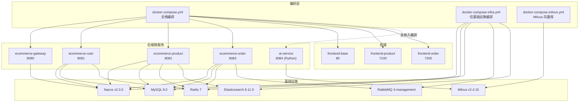
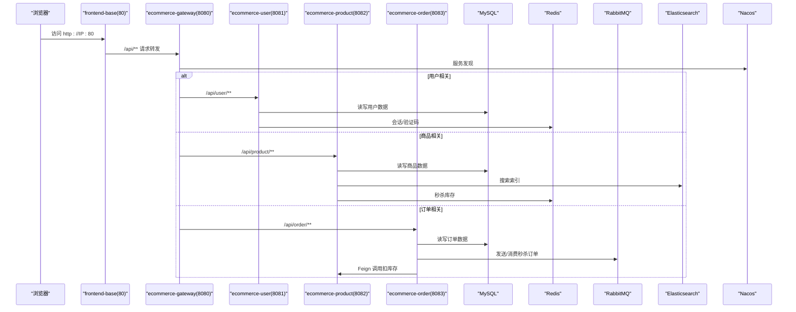
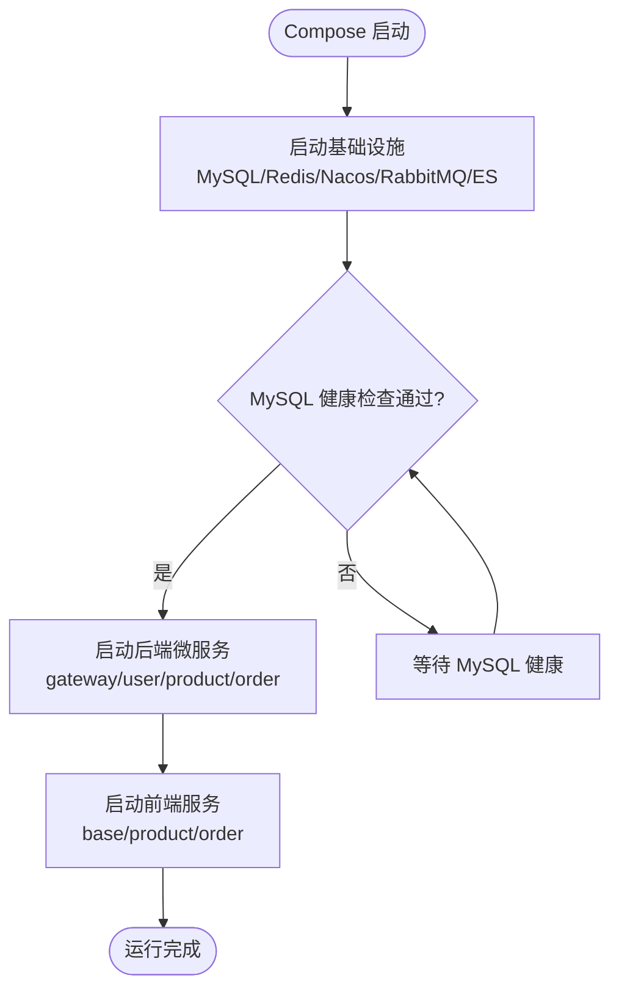

# 服务编排与依赖管理

<cite>
**本文引用的文件**   
- [docker-compose.yml](file://docker-compose.yml)
- [docker-compose-infra.yml](file://docker-compose-infra.yml)
- [docker-compose.milvus.yml](file://docker-compose.milvus.yml)
- [ai-service/README.md](file://ai-service/README.md)
- [scripts/deploy-milvus.ps1](file://scripts/deploy-milvus.ps1)
- [README.md](file://README.md)
- [Dockerfile.gateway](file://backend/Dockerfile.gateway)
- [Dockerfile.user](file://backend/Dockerfile.user)
- [Dockerfile.product](file://backend/Dockerfile.product)
- [Dockerfile.order](file://backend/Dockerfile.order)
- [frontend/base-app Dockerfile](file://frontend/base-app/Dockerfile)
- [frontend/product-app Dockerfile](file://frontend/product-app/Dockerfile)
- [frontend/order-app Dockerfile](file://frontend/order-app/Dockerfile)
</cite>

## 目录
1. [引言](#引言)
2. [项目结构](#项目结构)
3. [核心组件](#核心组件)
4. [架构总览](#架构总览)
5. [详细组件分析](#详细组件分析)
6. [依赖关系与服务启动顺序](#依赖关系与服务启动顺序)
7. [环境变量与配置映射](#环境变量与配置映射)
8. [端口映射与网络隔离](#端口映射与网络隔离)
9. [数据卷管理与初始化](#数据卷管理与初始化)
10. [健康检查机制](#健康检查机制)
11. [资源限制与性能考量](#资源限制与性能考量)
12. [服务启停与运维命令](#服务启停与运维命令)
13. [扩展新的微服务到编排配置](#扩展新的微服务到编排配置)
14. [故障排查指南](#故障排查指南)
15. [结论](#结论)

## 引言
本文件面向使用 Docker Compose 进行本地或服务器部署的读者，系统化说明本项目中的服务编排、依赖管理、环境变量、端口映射、数据卷、健康检查、网络隔离与资源限制。文档同时给出基础设施（MySQL、Redis、Nacos、Elasticsearch、RabbitMQ）的启动顺序与健康检查策略，并提供服务启动、停止、重启的操作指南，以及如何在现有编排中扩展新的微服务。需要特别注意的是：AI 问答服务 ai-service（Python）与向量库 Milvus 不包含在根 docker-compose.yml 中，Milvus 使用独立的 `docker-compose.milvus.yml` 部署，ai-service 以本地进程/虚拟环境方式启动。

## 项目结构
本项目采用前后端分离与微服务架构：
- 后端：Spring Cloud 微服务，包含网关、用户、商品、订单等模块，通过 Dockerfile 构建镜像。
- 前端：基于 qiankun 的微前端，包含主应用与两个子应用，分别由 Nginx 托管。
- 基础设施：MySQL、Redis、Nacos、RabbitMQ、Elasticsearch，提供数据库、缓存、注册中心、消息队列与搜索引擎能力。
- AI 能力：Milvus 由 `docker-compose.milvus.yml` 单独编排（etcd + MinIO + Milvus），ai-service 不在容器编排内，作为 Python 进程接入网关。
- 编排：提供全栈编排、仅基础设施编排、仅 Milvus 编排三套 compose 文件。

图表来源
- [docker-compose.yml:5-184](file://docker-compose.yml#L5-L184)
- [docker-compose-infra.yml:4-124](file://docker-compose-infra.yml#L4-L124)

章节来源
- [README.md:16-47](file://README.md#L16-L47)
- [README.md:430-477](file://README.md#L430-L477)

## 核心组件
- 基础设施服务
  - MySQL：关系型数据库，存储用户、商品、订单数据；支持 UTF-8 字符集与初始化脚本。
  - Redis：缓存与会话存储，秒杀库存预扣与验证码等热点数据。
  - Nacos：服务注册与发现、配置中心。
  - RabbitMQ：消息队列，用于秒杀订单异步处理。
  - Elasticsearch：商品搜索索引。
- 后端微服务
  - 网关：统一入口，JWT 鉴权，路由分发，Swagger 聚合。
  - 用户服务：认证、用户管理、短信/验证码、主题偏好。
  - 商品服务：商品 CRUD、ES 搜索、秒杀库存预扣。
  - 订单服务：订单管理、秒杀订单消费、Feign 调用商品服务、支付宝支付。
- AI 能力（独立部署）
  - ai-service：Python + FastAPI，PDF 知识库、RAG 检索与 SSE 问答；依赖 MySQL、Milvus 与外部 AI API。
  - Milvus：向量数据库，由独立 compose 编排，包含 etcd 与 MinIO。
- 前端
  - base-app：Vue 主应用，qiankun 容器与全局主题切换。
  - product-app：React 子应用，商品列表与详情、秒杀。
  - order-app：原生 TS 子应用，订单管理。

章节来源
- [README.md:1-15](file://README.md#L1-L15)
- [README.md:448-477](file://README.md#L448-L477)

## 架构总览
从编排视角看，compose 将基础设施与应用分层组织：
- 基础设施层：MySQL、Redis、Nacos、RabbitMQ、Elasticsearch。
- 后端服务层：Gateway、User、Product、Order。
- 前端层：base-app、product-app、order-app。
- 独立能力层：Milvus（compose）与 ai-service（进程），由网关 `/api/ai/**` 接入。

图表来源
- [docker-compose.yml:69-158](file://docker-compose.yml#L69-L158)
- [README.md:16-47](file://README.md#L16-L47)

## 详细组件分析

### 基础设施服务定义与配置
- MySQL
  - 镜像：mysql:8.0
  - 端口：3306
  - 环境变量：根密码、数据库名、语言环境（避免中文乱码）
  - 数据卷：持久化数据目录与初始化脚本挂载
  - 启动参数：默认认证插件、字符集与排序规则
  - 健康检查：mysqladmin ping
- Redis
  - 镜像：redis:7-alpine
  - 端口：6379
  - 数据卷：/data 持久化
- Nacos
  - 镜像：nacos/nacos-server:v2.3.0
  - 端口：8848、9848
  - 环境变量：standalone 模式、JVM 内存
- RabbitMQ
  - 镜像：rabbitmq:3-management-alpine
  - 端口：5672、15672
  - 环境变量：默认用户与密码
- Elasticsearch
  - 镜像：elasticsearch:8.11.0
  - 端口：9200
  - 环境变量：单节点、关闭安全、JVM 堆大小
  - 数据卷：/usr/share/elasticsearch/data

章节来源
- [docker-compose.yml:5-67](file://docker-compose.yml#L5-L67)
- [docker-compose-infra.yml:4-114](file://docker-compose-infra.yml#L4-L114)

### 后端微服务定义与依赖
- ecommerce-gateway
  - 构建：backend/Dockerfile.gateway
  - 端口：8080
  - 依赖：Nacos、Redis（service_started）
  - 环境变量：激活 docker profile、Nacos 地址、Redis 主机
- ecommerce-user
  - 构建：backend/Dockerfile.user
  - 端口：8081
  - 依赖：MySQL（healthy）、Nacos、Redis（service_started）
  - 环境变量：数据库连接、用户名密码、Redis 主机、Nacos 地址
- ecommerce-product
  - 构建：backend/Dockerfile.product
  - 端口：8082
  - 依赖：MySQL（healthy）、Nacos、Redis、Elasticsearch（service_started）
  - 环境变量：数据库连接、Redis 主机、ES URIs、RabbitMQ 主机、Nacos 地址
- ecommerce-order
  - 构建：backend/Dockerfile.order
  - 端口：8083
  - 依赖：MySQL（healthy）、Nacos、Redis、RabbitMQ（service_started）
  - 环境变量：数据库连接、Redis 主机、RabbitMQ 主机、Nacos 地址

章节来源
- [docker-compose.yml:69-158](file://docker-compose.yml#L69-L158)
- [Dockerfile.gateway:1-22](file://backend/Dockerfile.gateway#L1-L22)
- [Dockerfile.user:1-22](file://backend/Dockerfile.user#L1-L22)
- [Dockerfile.product:1-22](file://backend/Dockerfile.product#L1-L22)
- [Dockerfile.order:1-22](file://backend/Dockerfile.order#L1-L22)

### 前端服务定义与依赖
- frontend-base
  - 构建：frontend/base-app
  - 端口：80
  - 依赖：ecommerce-gateway
- frontend-product
  - 构建：frontend/product-app
  - 端口：7100
- frontend-order
  - 构建：frontend/order-app
  - 端口：7200

章节来源
- [docker-compose.yml:160-179](file://docker-compose.yml#L160-L179)
- [frontend/base-app Dockerfile:1-12](file://frontend/base-app/Dockerfile#L1-L12)
- [frontend/product-app Dockerfile:1-12](file://frontend/product-app/Dockerfile#L1-L12)
- [frontend/order-app Dockerfile:1-12](file://frontend/order-app/Dockerfile#L1-L12)

## 依赖关系与服务启动顺序
Compose 通过 depends_on 控制启动顺序：
- 网关依赖 Nacos 与 Redis 已启动。
- 用户、商品、订单服务依赖 MySQL 健康、Nacos 与 Redis 已启动；商品还依赖 ES 已启动；订单还依赖 RabbitMQ 已启动。
- 前端 base-app 依赖网关已启动。

图表来源
- [docker-compose.yml:77-150](file://docker-compose.yml#L77-L150)
- [docker-compose.yml:22-26](file://docker-compose.yml#L22-L26)

章节来源
- [docker-compose.yml:77-150](file://docker-compose.yml#L77-L150)

## 环境变量与配置映射
- 通用后端环境变量
  - SPRING_PROFILES_ACTIVE=docker：启用 docker 配置文件。
  - SPRING_CLOUD_NACOS_DISCOVERY_SERVER_ADDR=nacos:8848：Nacos 服务发现地址。
  - SPRING_DATA_REDIS_HOST=redis：Redis 主机名。
- 数据库连接
  - SPRING_DATASOURCE_URL：指向 mysql:3306/qoder_fullstack，含时区与安全参数。
  - SPRING_DATASOURCE_USERNAME=root
  - SPRING_DATASOURCE_PASSWORD=root
- 其他中间件
  - SPRING_ELASTICSEARCH_URIS=http://elasticsearch:9200
  - SPRING_RABBITMQ_HOST=rabbitmq

注意：
- 所有后端服务在 Compose 环境中通过容器名解析中间件主机名（如 mysql、redis、nacos、rabbitmq、elasticsearch）。
- 若需跨宿主机访问，请在各服务的 application.yml 中将 host 替换为 Docker 宿主 IP。
- 未纳入根编排的配置（需单独注入）：
  - ai-service：`AI_MYSQL_URL`、`MILVUS_HOST` / `MILVUS_PORT`、`ZHIPU_API_KEY`、`DASHSCOPE_API_KEY`、`MINERU_API_TOKEN`、`GATEWAY_JWT_SECRET`。
  - 商品服务图片：`OSS_ENDPOINT` / `OSS_BUCKET` / `OSS_ACCESS_KEY_ID` / `OSS_ACCESS_KEY_SECRET`（未配置则本地兜底）。
  - 订单服务支付：`ALIPAY_APP_ID` / `ALIPAY_PRIVATE_KEY` / `ALIPAY_PUBLIC_KEY` / `ALIPAY_NOTIFY_URL`。

章节来源
- [docker-compose.yml:82-158](file://docker-compose.yml#L82-L158)
- [README.md:478-502](file://README.md#L478-L502)

## 端口映射与网络隔离
- 端口映射
  - MySQL: 3306
  - Redis: 6379
  - Nacos: 8848, 9848
  - RabbitMQ: 5672, 15672
  - Elasticsearch: 9200
  - 网关: 8080
  - 用户服务: 8081
  - 商品服务: 8082
  - 订单服务: 8083
  - AI 问答服务: 8084（非根编排）
  - Milvus: 19530（gRPC）、9091（健康检查/指标）
  - 前端 base: 80
  - 前端 product: 7100
  - 前端 order: 7200
- 网络隔离
  - docker-compose-infra.yml 显式声明自定义桥接网络 ecommerce-net，并将基础设施服务加入该网络。
  - docker-compose.yml 未显式声明 networks，默认使用 Compose 自动创建的网络，服务间可通过容器名互通。

建议：
- 生产环境建议统一使用自定义网络，便于隔离与访问控制。
- 对外暴露的端口应结合防火墙与反向代理策略进行管控。

章节来源
- [docker-compose.yml:16-67](file://docker-compose.yml#L16-L67)
- [docker-compose-infra.yml:32-124](file://docker-compose-infra.yml#L32-L124)

## 数据卷管理与初始化
- 数据卷
  - mysql-data：MySQL 数据目录 /var/lib/mysql
  - redis-data：Redis 数据目录 /data
  - es-data：Elasticsearch 数据目录 /usr/share/elasticsearch/data
  - rabbitmq-data（infra）：RabbitMQ 数据目录 /var/lib/rabbitmq
  - milvus-data（milvus compose）：Milvus 数据目录 /opt/milvus（etcd 与 MinIO 各自使用数据卷）
- 初始化脚本
  - init-sql 目录挂载到 MySQL 容器的 /docker-entrypoint-initdb.d，容器首次启动自动执行建库建表与演示数据。
  - 为避免中文乱码，设置 LANG/LC_ALL 为 C.UTF-8，并在 command 中指定 utf8mb4 字符集与排序规则。

章节来源
- [docker-compose.yml:18-21](file://docker-compose.yml#L18-L21)
- [docker-compose.yml:181-184](file://docker-compose.yml#L181-L184)
- [docker-compose-infra.yml:19-26](file://docker-compose-infra.yml#L19-L26)
- [docker-compose-infra.yml:116-120](file://docker-compose-infra.yml#L116-L120)

## 健康检查机制
- MySQL
  - 健康检查：mysqladmin ping localhost
  - 间隔：10s，超时：5s，重试：5次
- Redis（infra）
  - 健康检查：redis-cli ping
  - 间隔：10s，超时：5s，重试：5次
- Nacos（infra）
  - 健康检查：curl -f http://localhost:8848/nacos/
  - 间隔：15s，超时：10s，重试：10次
- RabbitMQ（infra）
  - 健康检查：rabbitmq-diagnostics -q ping
  - 间隔：15s，超时：10s，重试：10次
- Elasticsearch（infra）
  - 健康检查：curl -f http://localhost:9200/_cluster/health
  - 间隔：15s，超时：10s，重试：10次

说明：
- docker-compose.yml 对 MySQL 定义了健康检查，业务服务通过 condition: service_healthy 确保数据库可用后再启动。
- docker-compose-infra.yml 对所有基础设施服务均定义了健康检查，便于独立运维与监控。

章节来源
- [docker-compose.yml:22-26](file://docker-compose.yml#L22-L26)
- [docker-compose-infra.yml:27-113](file://docker-compose-infra.yml#L27-L113)

## 资源限制与性能考量
- JVM 与容器内存
  - Nacos：JVM_XMS/JVM_XMX 设置为 256m（infra 中还包含 JVM_XMN=128m）。
  - Elasticsearch：ES_JAVA_OPTS 设置为 -Xms256m -Xmx256m。
- 磁盘与 I/O
  - MySQL、Redis、Elasticsearch、RabbitMQ 均使用数据卷持久化，避免容器重建丢失数据。
- CPU 与内存限制
  - Compose 文件中未显式设置 deploy.resources.limits/reservations，如需在生产环境限制资源，可在 services 下添加 deploy 配置或使用系统级 cgroup 限制。

优化建议：
- 根据实际负载调整 JVM 堆大小与 ES 堆大小。
- 对高并发场景考虑增加 Redis 实例、RabbitMQ 集群与 ES 分片副本。
- 使用外部日志收集与指标采集（Prometheus/Grafana）监控资源使用。

章节来源
- [docker-compose.yml:39-53](file://docker-compose.yml#L39-L53)
- [docker-compose-infra.yml:60-66](file://docker-compose-infra.yml#L60-L66)
- [docker-compose-infra.yml:101-105](file://docker-compose-infra.yml#L101-L105)

## 服务启停与运维命令
- 仅启动基础设施
  - docker compose -f docker-compose-infra.yml up -d
- 启动 Milvus（向量库）
  - docker compose -f docker-compose.milvus.yml up -d
  - 远程 VM 部署可用 `scripts/deploy-milvus.ps1`
- 全栈启动
  - docker compose up -d
- 停止服务
  - docker compose down
- 重启单个服务
  - docker compose restart <service_name>
- 查看服务状态
  - docker compose ps
- 查看日志
  - docker compose logs -f <service_name>
- 进入容器
  - docker exec -it <container_name> sh

参考：
- README 提供了基础设施与全栈部署的命令示例与访问地址清单。

章节来源
- [README.md:185-192](file://README.md#L185-L192)
- [README.md:430-446](file://README.md#L430-L446)
- [README.md:465-477](file://README.md#L465-L477)

## 扩展新的微服务到编排配置
步骤：
1. 新增后端模块
   - 在 backend 目录下新增模块目录与 Maven 配置。
   - 编写 Spring Boot 启动类与业务代码。
2. 新增 Dockerfile
   - 参考现有 backend/Dockerfile.* 模板，复制并修改目标端口与模块路径。
3. 在 docker-compose.yml 中添加服务定义
   - build.context 指向 ./backend
   - build.dockerfile 指向新 Dockerfile
   - container_name 命名规范：ecommerce-<service>
   - ports 映射宿主端口到容器端口
   - depends_on 声明依赖的基础设施或服务
   - environment 注入数据库、Redis、Nacos、RabbitMQ、ES 等环境变量
4. 更新服务发现与路由
   - 在 Nacos 中注册服务（由 Spring Cloud 自动完成）
   - 在网关中新增路由规则，将 /api/<domain>/** 转发到新服务
5. 可选：在 docker-compose-infra.yml 中补充健康检查与网络配置
6. 验证
   - docker compose up -d
   - 访问 Swagger 与接口测试
   - 检查日志与监控指标

注意事项：
- 保持环境变量命名一致，便于统一管理。
- 若新服务需要持久化数据，新增数据卷并挂载到容器内目录。
- 若新服务需要对外暴露端口，谨慎评估安全风险，建议使用网关统一入口。
- 非 JVM 服务（如 ai-service）可参考现有做法：不纳入 Maven/Nacos，在独立 compose 或宿主机运行，仅通过网关路径前缀接入，并对齐身份头与签名。

章节来源
- [docker-compose.yml:69-158](file://docker-compose.yml#L69-L158)
- [Dockerfile.gateway:1-22](file://backend/Dockerfile.gateway#L1-L22)

## 故障排查指南
常见问题与定位方法：
- 数据库连接失败
  - 检查 MySQL 健康检查是否通过，确认 MYSQL_ROOT_PASSWORD 与数据库名正确。
  - 确认 init-sql 已挂载且字符集配置正确。
- Redis 连接失败
  - 检查 Redis 端口与主机名是否正确，确认 Redis 容器运行正常。
- Nacos 不可用
  - 检查 Nacos 健康检查与端口映射，确认 MODE=standalone 与 JVM 内存足够。
- RabbitMQ 连接失败
  - 检查默认用户与密码，确认 Management 插件可用。
- Elasticsearch 不可用
  - 检查单节点配置与安全开关，确认堆内存设置合理。
- 微服务启动失败
  - 检查 depends_on 条件是否满足（service_healthy/service_started）。
  - 检查环境变量是否正确注入，尤其是数据库 URL、用户名、密码与中间件主机名。
- 前端无法访问
  - 检查 base-app 是否依赖 gateway，确认网关端口与路由配置正确。
- Milvus 不可用
  - 检查 `docker compose -f docker-compose.milvus.yml ps`，确认 etcd、MinIO、Milvus 三容器均健康；ai-service 启动时 Milvus 不可用只会告警，不阻断启动，但知识库入库与检索会失败。
- ai-service 无法访问
  - 确认 8084 已监听、`GATEWAY_JWT_SECRET` 与网关闭一致；若容器内网关需要访问宿主机服务，注意 host 映射。

章节来源
- [docker-compose.yml:22-26](file://docker-compose.yml#L22-L26)
- [docker-compose.yml:77-150](file://docker-compose.yml#L77-L150)
- [docker-compose-infra.yml:27-113](file://docker-compose-infra.yml#L27-L113)

## 结论
本编排方案通过 Compose 将基础设施、后端微服务与前端应用统一组织，利用 depends_on 与健康检查保证服务启动顺序与可用性，通过环境变量与数据卷实现配置与数据的可移植性；Milvus 与 ai-service 以独立编排/进程方式接入，保持主编排的稳定性。建议在生产环境中引入自定义网络、资源限制与外部监控，以进一步提升稳定性与可观测性。扩展新微服务时，遵循现有模板与约定，可快速集成到整体编排中。