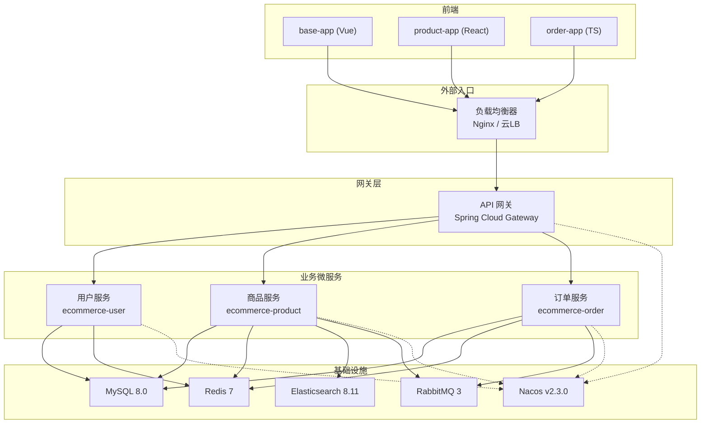
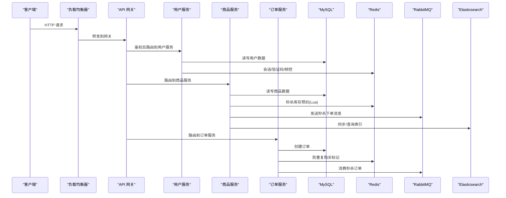
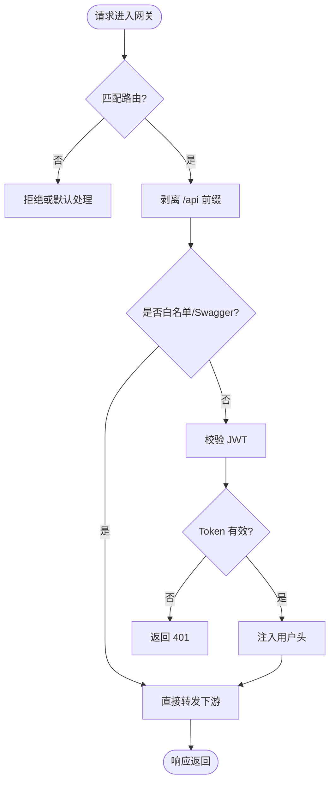
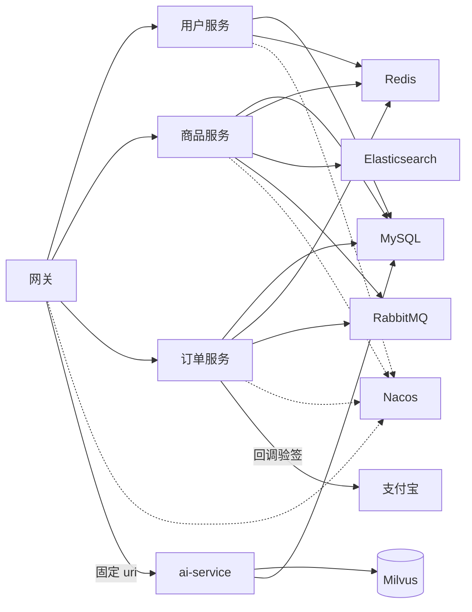
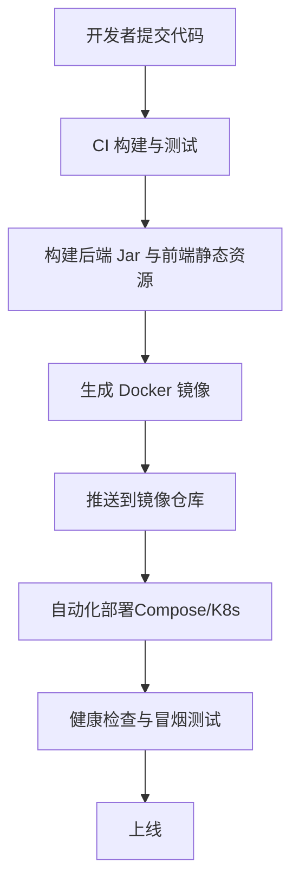

# 生产环境部署

<cite>
**本文引用的文件**   
- [README.md](file://README.md)
- [docker-compose.yml](file://docker-compose.yml)
- [docker-compose-infra.yml](file://docker-compose-infra.yml)
- [backend/Dockerfile.gateway](file://backend/Dockerfile.gateway)
- [backend/Dockerfile.user](file://backend/Dockerfile.user)
- [backend/Dockerfile.product](file://backend/Dockerfile.product)
- [backend/Dockerfile.order](file://backend/Dockerfile.order)
- [frontend/base-app/Dockerfile](file://frontend/base-app/Dockerfile)
- [frontend/product-app/Dockerfile](file://frontend/product-app/Dockerfile)
- [frontend/order-app/Dockerfile](file://frontend/order-app/Dockerfile)
- [backend/ecommerce-gateway/src/main/resources/application.yml](file://backend/ecommerce-gateway/src/main/resources/application.yml)
- [backend/ecommerce-user/src/main/resources/application.yml](file://backend/ecommerce-user/src/main/resources/application.yml)
- [backend/ecommerce-product/src/main/resources/application.yml](file://backend/ecommerce-product/src/main/resources/application.yml)
- [backend/ecommerce-order/src/main/resources/application.yml](file://backend/ecommerce-order/src/main/resources/application.yml)
- [docker-compose.milvus.yml](file://docker-compose.milvus.yml)
- [ai-service/app/config.py](file://ai-service/app/config.py)
- [ai-service/README.md](file://ai-service/README.md)
- [backend/ecommerce-common/src/main/java/com/ecommerce/common/security/TrustedAuthenticationFilter.java](file://backend/ecommerce-common/src/main/java/com/ecommerce/common/security/TrustedAuthenticationFilter.java)
</cite>

## 目录
1. [引言](#引言)
2. [项目结构](#项目结构)
3. [核心组件](#核心组件)
4. [架构总览](#架构总览)
5. [详细组件分析](#详细组件分析)
6. [依赖关系分析](#依赖关系分析)
7. [性能调优建议](#性能调优建议)
8. [安全与合规配置](#安全与合规配置)
9. [部署与自动化流水线](#部署与自动化流水线)
10. [监控、日志与故障恢复](#监控日志与故障恢复)
11. [灰度发布与回滚策略](#灰度发布与回滚策略)
12. [常见问题排查](#常见问题排查)
13. [结论](#结论)

## 引言
本指南面向生产环境，基于仓库中的 Spring Cloud 微服务与 qiankun 微前端架构，给出负载均衡、服务发现、配置中心、数据库、缓存、消息队列的部署方案；同时覆盖安全配置、性能调优、自动化流水线、灰度发布与回滚、监控告警与日志收集、故障恢复等生产级要求。

## 项目结构
后端采用 Spring Boot + Spring Cloud 微服务拆分：网关、用户、商品、订单四个服务，配合 Nacos（注册与配置）、MySQL、Redis、RabbitMQ、Elasticsearch 中间件；前端为 qiankun 主应用与两个子应用，统一由 Nginx 托管。

图示来源
- [docker-compose.yml:4-179](file://docker-compose.yml#L4-L179)
- [docker-compose-infra.yml:4-125](file://docker-compose-infra.yml#L4-L125)
- [backend/ecommerce-gateway/src/main/resources/application.yml:12-110](file://backend/ecommerce-gateway/src/main/resources/application.yml#L12-L110)

章节来源
- [README.md:16-47](file://README.md#L16-L47)
- [docker-compose.yml:4-179](file://docker-compose.yml#L4-L179)
- [docker-compose-infra.yml:4-125](file://docker-compose-infra.yml#L4-L125)

## 核心组件
- API 网关：统一入口、JWT 鉴权、路由转发、Swagger 聚合。
- 用户服务：认证、用户管理、验证码、短信、主题偏好。
- 商品服务：商品 CRUD、ES 搜索、秒杀库存预扣、Lua 脚本。
- 订单服务：订单管理、Feign 调用商品服务、RabbitMQ 异步消费秒杀订单、支付宝沙箱支付与回调。
- ai-service（Python）：保险咨询 RAG 问答，经网关 `/api/ai/**` 代理，依赖 Milvus 与 MySQL。
- 基础设施：MySQL、Redis、Nacos、RabbitMQ、Elasticsearch；向量检索额外依赖 Milvus（独立 compose）。
- 前端：qiankun 主应用与子应用，Nginx 托管静态资源。

章节来源
- [README.md:5-14](file://README.md#L5-L14)
- [README.md:280-331](file://README.md#L280-L331)
- [README.md:366-379](file://README.md#L366-L379)

## 架构总览
生产环境推荐将网关前置到负载均衡器，所有外部流量经 LB 进入网关；微服务通过 Nacos 完成服务发现与动态配置；数据层使用 MySQL 集群、Redis 集群、RabbitMQ 集群、Elasticsearch 集群；前端静态资源通过 CDN/Nginx 分发。

图示来源
- [backend/ecommerce-gateway/src/main/resources/application.yml:22-67](file://backend/ecommerce-gateway/src/main/resources/application.yml#L22-L67)
- [backend/ecommerce-product/src/main/resources/application.yml:25-47](file://backend/ecommerce-product/src/main/resources/application.yml#L25-L47)
- [backend/ecommerce-order/src/main/resources/application.yml:25-44](file://backend/ecommerce-order/src/main/resources/application.yml#L25-L44)

## 详细组件分析

### API 网关（负载均衡与鉴权）
- 路由规则：按路径前缀分发到用户、商品、订单服务，并剥离 /api 前缀。
- 全局 CORS：允许跨域访问，便于微前端开发联调。
- Swagger 聚合：集中展示各服务文档，路径加入鉴权白名单。
- JWT 校验：从 Authorization 头解析 Token，通过后透传 X-User-Id/X-User-Name。

图示来源
- [backend/ecommerce-gateway/src/main/resources/application.yml:12-110](file://backend/ecommerce-gateway/src/main/resources/application.yml#L12-L110)
- [backend/ecommerce-gateway/src/main/resources/application.yml:112-131](file://backend/ecommerce-gateway/src/main/resources/application.yml#L112-L131)

章节来源
- [backend/ecommerce-gateway/src/main/resources/application.yml:1-131](file://backend/ecommerce-gateway/src/main/resources/application.yml#L1-L131)

### 用户服务（认证与会话）
- 端口与上下文：8081，context-path /user。
- 数据源：MySQL 连接参数在 application.yml 中定义。
- Redis：用于会话 Token、图片验证码、短信频控。
- Nacos：服务发现地址。
- JWT：签名密钥与有效期。

章节来源
- [backend/ecommerce-user/src/main/resources/application.yml:1-97](file://backend/ecommerce-user/src/main/resources/application.yml#L1-L97)

### 商品服务（搜索与秒杀）
- 端口与上下文：8082，context-path /product。
- 数据源：MySQL。
- Redis：秒杀库存预扣（Lua）。
- RabbitMQ：生产者确认与返回回调。
- Elasticsearch：商品索引启用与连接。
- Nacos：服务发现。

章节来源
- [backend/ecommerce-product/src/main/resources/application.yml:1-74](file://backend/ecommerce-product/src/main/resources/application.yml#L1-L74)

### 订单服务（异步消费）
- 端口与上下文：8083，context-path /order。
- 数据源：MySQL。
- Redis：防重复购买标记。
- RabbitMQ：手动 ACK、prefetch=1、重试策略。
- OpenFeign：调用商品服务扣减库存。
- Nacos：服务发现。

章节来源
- [backend/ecommerce-order/src/main/resources/application.yml:1-79](file://backend/ecommerce-order/src/main/resources/application.yml#L1-L79)

### 前端（微前端与静态资源）
- base-app：Vue 3 + Element Plus，Nginx 托管，暴露 80。
- product-app：React + Ant Design，Nginx 托管，暴露 7100。
- order-app：原生 TS，Nginx 托管，暴露 7200。
- 构建镜像：Node 20 构建，Nginx 运行。

章节来源
- [frontend/base-app/Dockerfile:1-12](file://frontend/base-app/Dockerfile#L1-L12)
- [frontend/product-app/Dockerfile:1-12](file://frontend/product-app/Dockerfile#L1-L12)
- [frontend/order-app/Dockerfile:1-12](file://frontend/order-app/Dockerfile#L1-L12)

## 依赖关系分析
- 网关依赖 Nacos 进行服务发现，依赖 Redis 做限流/白名单扩展（可选），依赖下游微服务。
- 用户服务依赖 MySQL、Redis、Nacos。
- 商品服务依赖 MySQL、Redis、Elasticsearch、RabbitMQ、Nacos。
- 订单服务依赖 MySQL、Redis、RabbitMQ、Nacos，并通过 OpenFeign 调用商品服务；对外依赖支付宝开放平台（异步通知需公网可达）。
- ai-service 依赖 MySQL（会话/文档元数据）、Milvus（向量）、智谱 GLM（生成）与百炼 Embedding；不注册 Nacos，由网关固定 `uri` 代理。

图示来源
- [docker-compose.yml:69-158](file://docker-compose.yml#L69-L158)
- [backend/ecommerce-gateway/src/main/resources/application.yml:8-11](file://backend/ecommerce-gateway/src/main/resources/application.yml#L8-L11)

章节来源
- [docker-compose.yml:69-158](file://docker-compose.yml#L69-L158)

## 性能调优建议
- JVM 参数优化
  - 网关与服务容器未显式设置 JVM 堆大小，生产环境建议根据实例规格设置 -Xms/-Xmx，避免频繁 GC。
  - Nacos 与 ES 容器已设置较小堆内存，生产应扩容至合理值（例如 2G+），并结合 G1GC 参数优化。
- 数据库连接池
  - 当前使用 MyBatis + JDBC 直连，未显式配置连接池；建议引入 HikariCP 并调整最大连接数、空闲连接、超时时间，结合数据库 CPU/IO 能力评估。
- Redis 连接池
  - Lettuce 连接池 max-active/max-idle 均为 8，高并发场景可适度提升，同时关注 Redis 服务端连接数上限与网络带宽。
- 缓存策略
  - 秒杀库存使用 Redis Lua 原子预扣，减少热点写竞争；建议增加本地缓存（如 Caffeine）对热点商品元数据进行短 TTL 缓存。
- 索引优化
  - ES 商品索引需根据查询维度（关键词、分类、价格区间）设计 mapping 与分词器；定期重建索引，避免全量同步阻塞。
- 消息队列
  - 订单消费者 prefetch=1，适合串行处理；若吞吐不足，可增加消费者并行度与重试策略，结合死信队列处理失败消息。

章节来源
- [backend/ecommerce-user/src/main/resources/application.yml:17-28](file://backend/ecommerce-user/src/main/resources/application.yml#L17-L28)
- [backend/ecommerce-product/src/main/resources/application.yml:14-24](file://backend/ecommerce-product/src/main/resources/application.yml#L14-L24)
- [backend/ecommerce-order/src/main/resources/application.yml:14-24](file://backend/ecommerce-order/src/main/resources/application.yml#L14-L24)
- [backend/ecommerce-order/src/main/resources/application.yml:25-44](file://backend/ecommerce-order/src/main/resources/application.yml#L25-L44)
- [docker-compose.yml:36-57](file://docker-compose.yml#L36-L57)

## 安全与合规配置
- SSL/TLS
  - 网关与前端 Nginx 应启用 HTTPS，证书由可信 CA 签发；关闭明文传输，强制 HSTS。
  - 数据库连接建议开启 TLS（useSSL=true），并配置信任库与主机名校验。
- 防火墙与网络隔离
  - 仅开放 80/443（前端与网关）与必要管理端口（如 Nacos/RabbitMQ 控制台仅限内网访问）；数据库、Redis、ES、MQ 不对外暴露。
- 访问控制
  - 网关 JWT 校验严格化，Secret 使用强随机字符串并轮换；下游服务信任网关注入的用户头，避免重复校验。
  - **生产必须开启网关签名校验**：各下游服务配置 `security.trusted-header.verify-signature=true`，否则任何能直连 8081/8082/8083 的调用方都可伪造 `X-User-*` 获得身份；同时保证 `jwt.secret` 与网关一致。
  - 单设备会话依赖 Redis 比对（`gateway.session-check.enabled` 默认开启），不要在生产关闭；Redis 异常时网关会降级放行，属可用性取舍。
  - Nacos 与 RabbitMQ 控制台启用认证，最小权限原则。
- 数据加密
  - 敏感字段（密码、手机号）在数据库中加密存储；传输层使用 TLS；Redis 可启用 ACL 与密码保护。
- 审计与合规
  - 登录、注册、短信发送、订单操作记录审计日志；定期清理临时数据（验证码、短信记录）。
- 支付与对象存储
  - 支付宝回调地址必须是公网可达的 HTTPS 地址（`ALIPAY_NOTIFY_URL`），并确保网关白名单存在 `/api/order/payments/alipay/notify`，安全由验签与金额校验保证。
  - 图片上传生产建议使用 OSS（`OSS_*` 环境变量），本地盘方案在多实例下会因实例不同而无法互访。
  - 上传限额三处对齐：前端 `ImageUploader`、后端 multipart、Nginx `client_max_body_size`。
- AI 服务凭据
  - `ZHIPU_API_KEY`、`DASHSCOPE_API_KEY` 仅通过环境变量注入；`VERIFY_GATEWAY_SIGNATURE=true` 时 `GATEWAY_JWT_SECRET` 必须与 Java 侧一致。

章节来源
- [backend/ecommerce-gateway/src/main/resources/application.yml:112-115](file://backend/ecommerce-gateway/src/main/resources/application.yml#L112-L115)
- [backend/ecommerce-user/src/main/resources/application.yml:50-53](file://backend/ecommerce-user/src/main/resources/application.yml#L50-L53)
- [backend/ecommerce-product/src/main/resources/application.yml:56-58](file://backend/ecommerce-product/src/main/resources/application.yml#L56-L58)
- [backend/ecommerce-order/src/main/resources/application.yml:53-55](file://backend/ecommerce-order/src/main/resources/application.yml#L53-L55)

## 部署与自动化流水线
- 容器化构建
  - 后端服务使用多阶段构建：Maven 构建 Jar，JRE 镜像运行。
  - 前端使用 Node 构建静态资源，Nginx 镜像托管。
- Docker Compose
  - 提供全栈编排与仅基础设施编排两种模式；服务间依赖通过 depends_on 与 healthcheck 保障启动顺序。
- CI/CD 流水线建议
  - 代码提交触发单元测试与静态检查；构建镜像并推送镜像仓库；Kubernetes/Helm 或 Docker Compose 自动部署；健康检查通过后切换流量。
- 异构服务发布
  - ai-service 以 Python 依赖锁定（`requirements.txt`）+ 虚拟环境/进程守护发布；发布后用 `GET /api/ai/health` 做冒烟验证。
  - Milvus 用独立 compose 部署，升级前备份 `/opt/milvus`（etcd + MinIO + data），变更 embedding 模型需重建集合。

图示来源
- [backend/Dockerfile.gateway:1-22](file://backend/Dockerfile.gateway#L1-L22)
- [backend/Dockerfile.user:1-22](file://backend/Dockerfile.user#L1-L22)
- [backend/Dockerfile.product:1-22](file://backend/Dockerfile.product#L1-L22)
- [backend/Dockerfile.order:1-22](file://backend/Dockerfile.order#L1-L22)
- [frontend/base-app/Dockerfile:1-12](file://frontend/base-app/Dockerfile#L1-L12)
- [frontend/product-app/Dockerfile:1-12](file://frontend/product-app/Dockerfile#L1-L12)
- [frontend/order-app/Dockerfile:1-12](file://frontend/order-app/Dockerfile#L1-L12)
- [docker-compose.yml:69-179](file://docker-compose.yml#L69-L179)

章节来源
- [docker-compose.yml:4-179](file://docker-compose.yml#L4-L179)
- [docker-compose-infra.yml:4-125](file://docker-compose-infra.yml#L4-L125)

## 监控、日志与故障恢复
- 监控指标
  - 网关：QPS、延迟、错误率、上游服务可用性，以及 40101（会话失效）占比。
  - 微服务：JVM 指标、线程池、GC、数据库连接池、Redis/MQ 连接数。
  - 基础设施：CPU/内存/磁盘 IO、数据库慢查询、ES 集群健康、MQ 堆积。
  - AI 与向量：`/api/ai/health` 存活、对话首字节延迟、Milvus 查询 P99 与集合行数。
- 日志收集
  - 应用日志输出到 stdout/stderr，由容器日志驱动采集；结构化 JSON 格式便于检索。
  - 集中式日志平台（如 ELK/EFK）统一收集与分析。
- 告警规则
  - 服务不可用、错误率突增、延迟 P99 升高、数据库连接耗尽、Redis/MQ 异常、ES 集群状态异常。
- 故障恢复
  - 网关与健康检查：服务重启后自动注册；失败实例剔除。
  - 幂等与重试：订单消费者手动 ACK，失败重试；死信队列兜底。
  - 数据一致性：秒杀 Lua 原子预扣 + MQ 异步下单，保证最终一致。

章节来源
- [backend/ecommerce-order/src/main/resources/application.yml:25-44](file://backend/ecommerce-order/src/main/resources/application.yml#L25-L44)
- [README.md:415-429](file://README.md#L415-L429)

## 灰度发布与回滚策略
- 灰度发布
  - 网关按权重或标签分流，逐步放量新版本；结合金丝雀发布与 A/B 测试验证稳定性。
  - 前端子应用独立版本，通过路由映射灰度域名或路径。
- 回滚策略
  - 保留上一版本镜像与配置；一键回滚到稳定版本；数据库变更需兼容双写或迁移脚本可逆。
- 健康检查与熔断
  - 网关对下游服务进行健康探测；异常自动摘除；结合熔断降级保护系统整体可用。

章节来源
- [backend/ecommerce-gateway/src/main/resources/application.yml:12-110](file://backend/ecommerce-gateway/src/main/resources/application.yml#L12-L110)

## 常见问题排查
- 数据库初始化乱码
  - 确保 MySQL 容器环境变量 LANG/LC_ALL 设置为 UTF-8，并使用 utf8mb4 字符集；执行初始化脚本时指定 --default-character-set=utf8mb4。
- 中间件连接失败
  - 检查 application.yml 中 MySQL/Redis/RabbitMQ/Elasticsearch/Nacos 的地址与端口；Docker 环境下使用服务名而非 localhost。
- 网关路由异常
  - 核对路由规则与 StripPrefix 配置；确认下游服务 context-path 与端口。
- 秒杀超卖或重复购买
  - 确认 Redis Lua 脚本执行成功；检查用户购买标记键是否写入；观察 MQ 消费是否成功。
- 前端代理问题
  - 确认 Vite 开发代理指向网关 8080；生产环境 Nginx 反向代理配置正确。
- 支付回调未生效
  - 公网地址不可达或未放行；确认回调日志中验签、app_id、金额校验均通过，且条件更新确实命中。
- ai-service 不可用
  - 网关侧固定 uri 在容器场景需改为 `host.docker.internal` 或服务名；确认 8084 已监听、`/api/ai/health` 正常、Milvus 19530 可达。

章节来源
- [docker-compose-infra.yml:14-26](file://docker-compose-infra.yml#L14-L26)
- [docker-compose.yml:8-21](file://docker-compose.yml#L8-L21)
- [backend/ecommerce-gateway/src/main/resources/application.yml:22-67](file://backend/ecommerce-gateway/src/main/resources/application.yml#L22-L67)
- [README.md:173-181](file://README.md#L173-L181)

## 结论
本指南基于现有仓库结构与配置，给出了生产环境的完整部署蓝图与安全、性能、运维实践建议。除 Java 微服务外，支付需要公网回调与验签、图片需要稳定的对象存储、AI 咨询需要独立的 Milvus 与其进程守护，这些外部依赖应在容量与发布计划中单独列出。实际落地时，请结合企业规范替换敏感配置、启用 TLS、开启网关签名校验，完善监控告警与日志体系，并通过 CI/CD 实现自动化发布与回滚，确保系统在高可用与高性能下稳定运行。