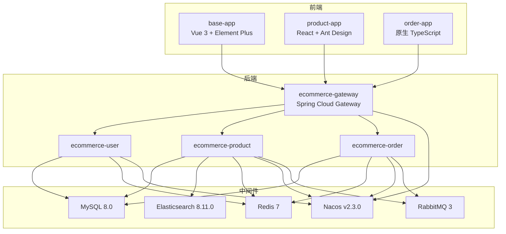
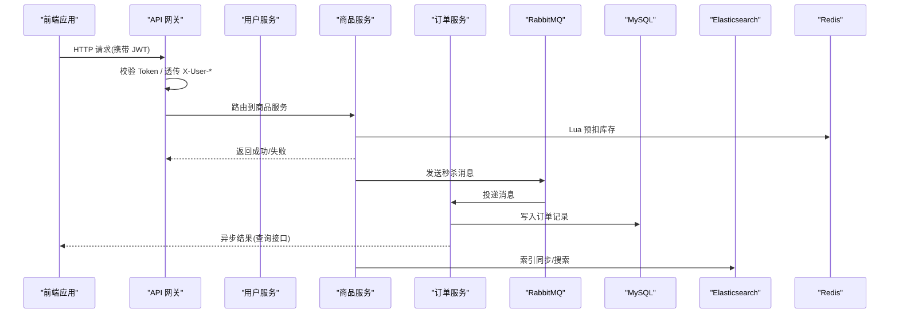
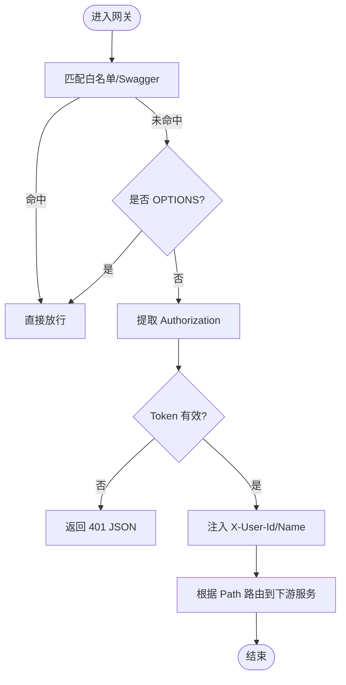
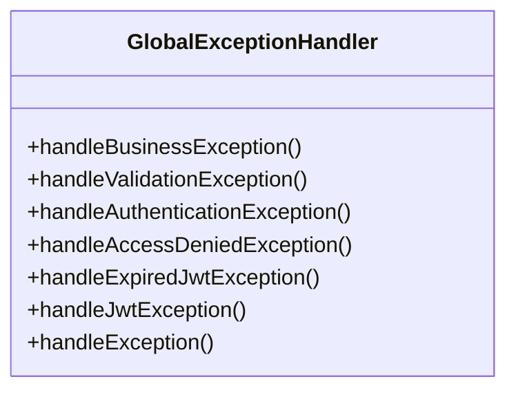
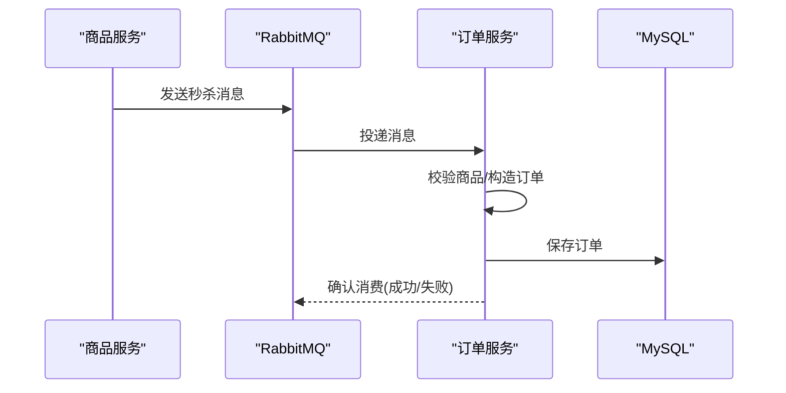
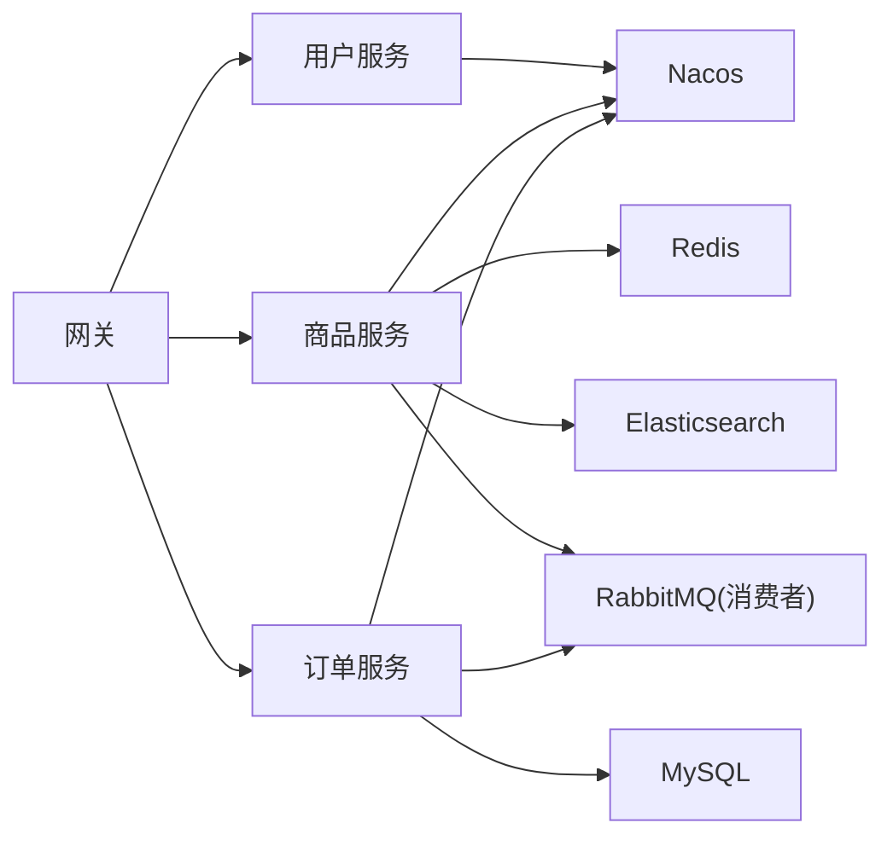

# 监控与运维

<cite>
**本文引用的文件**   
- [README.md](file://README.md)
- [ecommerce-gateway application.yml](file://backend/ecommerce-gateway/src/main/resources/application.yml)
- [AuthGlobalFilter.java](file://backend/ecommerce-gateway/src/main/java/com/ecommerce/gateway/filter/AuthGlobalFilter.java)
- [GlobalExceptionHandler.java](file://backend/ecommerce-common/src/main/java/com/ecommerce/common/GlobalExceptionHandler.java)
- [ecommerce-user application.yml](file://backend/ecommerce-user/src/main/resources/application.yml)
- [ecommerce-product application.yml](file://backend/ecommerce-product/src/main/resources/application.yml)
- [ecommerce-order application.yml](file://backend/ecommerce-order/src/main/resources/application.yml)
- [SeckillOrderConsumer.java](file://backend/ecommerce-order/src/main/java/com/ecommerce/order/consumer/SeckillOrderConsumer.java)
- [Dockerfile.gateway](file://backend/Dockerfile.gateway)
- [Dockerfile.product](file://backend/Dockerfile.product)
- [docker-compose-infra.yml](file://docker-compose-infra.yml)
- [docker-compose.yml](file://docker-compose.yml)
- [vm-ssh.js](file://vm-ssh.js)
</cite>

## 目录
1. [引言](#引言)
2. [项目结构](#项目结构)
3. [核心组件](#核心组件)
4. [架构总览](#架构总览)
5. [详细组件分析](#详细组件分析)
6. [依赖关系分析](#依赖关系分析)
7. [性能与容量规划](#性能与容量规划)
8. [故障诊断指南](#故障诊断指南)
9. [自动化运维与脚本示例](#自动化运维与脚本示例)
10. [安全审计与合规性检查](#安全审计与合规性检查)
11. [数据迁移与备份恢复](#数据迁移与备份恢复)
12. [结论](#结论)

## 引言
本文件面向运维与SRE团队，围绕该前后端分离、微服务+微前端的电商系统，提供一套可落地的监控与运维方案。内容覆盖应用性能监控、业务指标收集、错误日志采集、链路追踪、日志分析、性能分析、容量规划、备份恢复、故障诊断方法、自动化运维流程、应急预案制定，以及安全审计、合规性检查与数据迁移最佳实践。

## 项目结构
后端采用 Spring Cloud 微服务架构，包含网关、用户、商品、订单等模块；前端基于 qiankun 微前端，拆分为主应用与两个子应用。基础设施通过 Docker Compose 编排 MySQL、Redis、Nacos、RabbitMQ、Elasticsearch；此外还有一个异构的 Python `ai-service`（8084，不走 compose）与独立编排的 Milvus 向量库（19530）需要单独纳入监控。

**图示来源**
- [README.md:16-47](file://README.md#L16-L47)
- [ecommerce-gateway application.yml:22-67](file://backend/ecommerce-gateway/src/main/resources/application.yml#L22-L67)

**章节来源**
- [README.md:1-149](file://README.md#L1-L149)

## 核心组件
- API 网关：统一入口、JWT 鉴权、路由分发、Swagger 聚合。
- 用户服务：认证、用户管理、验证码、短信、主题偏好。
- 商品服务：商品 CRUD、ES 搜索、秒杀库存预扣（Redis Lua）、RabbitMQ 异步下单。
- 订单服务：订单 CRUD、Feign 调用商品服务、RabbitMQ 消费者异步创建订单、支付宝沙箱支付与回调。
- 全局异常处理：统一异常包装为 Result，便于日志与告警。
- AI 服务（`ai-service`）：保险咨询 RAG（FastAPI + LangGraph），依赖 Milvus 与 MySQL 的 `ai_*` 表，经网关 `/api/ai/**` 暴露。
- 基础设施：MySQL、Redis、Nacos、RabbitMQ、Elasticsearch，以及独立 compose 的 Milvus。

**章节来源**
- [README.md:5-15](file://README.md#L5-L15)
- [README.md:280-331](file://README.md#L280-L331)
- [GlobalExceptionHandler.java:17-73](file://backend/ecommerce-common/src/main/java/com/ecommerce/common/GlobalExceptionHandler.java#L17-L73)

## 架构总览
从请求到数据的端到端路径如下：前端通过浏览器访问 Nginx 托管的主应用，主应用加载子应用；所有后端请求经 API 网关统一鉴权后路由至对应微服务；微服务通过 Nacos 注册发现，使用 Redis 缓存热点数据，MySQL 持久化核心数据，Elasticsearch 提供商品检索，RabbitMQ 解耦秒杀下单。

**图示来源**
- [AuthGlobalFilter.java:80-140](file://backend/ecommerce-gateway/src/main/java/com/ecommerce/gateway/filter/AuthGlobalFilter.java#L80-L140)
- [ecommerce-product application.yml:25-42](file://backend/ecommerce-product/src/main/resources/application.yml#L25-L42)
- [ecommerce-order application.yml:25-40](file://backend/ecommerce-order/src/main/resources/application.yml#L25-L40)

## 详细组件分析

### 网关鉴权与路由
- 鉴权逻辑：白名单放行、OPTIONS 放行、提取 Authorization Bearer、解析 JWT、注入 X-User-Id/X-User-Name 头、失败直接返回 401。
- 路由规则：按 /api/user/**、/api/product/**、/api/order/** 分发，并转发 Swagger UI 与 OpenAPI 文档。

**图示来源**
- [AuthGlobalFilter.java:80-140](file://backend/ecommerce-gateway/src/main/java/com/ecommerce/gateway/filter/AuthGlobalFilter.java#L80-L140)
- [ecommerce-gateway application.yml:22-67](file://backend/ecommerce-gateway/src/main/resources/application.yml#L22-L67)

**章节来源**
- [AuthGlobalFilter.java:31-170](file://backend/ecommerce-gateway/src/main/java/com/ecommerce/gateway/filter/AuthGlobalFilter.java#L31-L170)
- [ecommerce-gateway application.yml:1-131](file://backend/ecommerce-gateway/src/main/resources/application.yml#L1-L131)

### 全局异常处理与错误日志
- 统一将业务异常、参数校验异常、认证/授权异常、Token 异常、兜底异常转换为 Result 结构，并通过 SLF4J 输出 warn/error 日志，便于集中采集与告警。

**图示来源**
- [GlobalExceptionHandler.java:17-73](file://backend/ecommerce-common/src/main/java/com/ecommerce/common/GlobalExceptionHandler.java#L17-L73)

**章节来源**
- [GlobalExceptionHandler.java:1-74](file://backend/ecommerce-common/src/main/java/com/ecommerce/common/GlobalExceptionHandler.java#L1-L74)

### 秒杀订单异步消费
- 商品服务通过 RabbitMQ 发送 SeckillMessage，订单服务监听队列，验证商品、创建订单记录，失败抛出异常触发重试机制。

**图示来源**
- [SeckillOrderConsumer.java:35-68](file://backend/ecommerce-order/src/main/java/com/ecommerce/order/consumer/SeckillOrderConsumer.java#L35-L68)
- [ecommerce-order application.yml:25-40](file://backend/ecommerce-order/src/main/resources/application.yml#L25-L40)

**章节来源**
- [SeckillOrderConsumer.java:1-70](file://backend/ecommerce-order/src/main/java/com/ecommerce/order/consumer/SeckillOrderConsumer.java#L1-L70)
- [ecommerce-order application.yml:1-79](file://backend/ecommerce-order/src/main/resources/application.yml#L1-L79)

### 新增能力的可观测点（会话 / 支付 / 上传 / AI）
- 会话与鉴权
  - 指标：网关 `40101` 计数（按路径聚合）、`login:token:*` Key 数量与在线用户数差值、Redis 命令延迟与连接池耗尽次数。
  - 告警：`40101` 短时间内骤增且命中多个用户 → 优先排查 Redis 会话覆盖/不可用，而非用户行为。
- 支付
  - 指标：`payment_record` 各状态分布、停留 `CREATED` 超过支付超时（默认 30m）的订单数、`notify` 接口非 200 次数。
  - 日志：告警关键字 `[ALIPAY-ALARM]`（参数未配置 / 验签失败 / app_id 不匹配 / 金额不一致）；`notify_url` 不可达时只能依赖前端轮询的 `sync=true` 主动查单。
- 图片上传
  - 指标：上传成功率、OSS 4xx/5xx、回落本地存储次数、本地 `uploads` 目录磁盘占用（容器未挂卷时重启即丢）。
  - 告警：413/400 突增常见于前置 Nginx `client_max_body_size` 与后端 5MB 限制不一致。
- AI 服务与向量库
  - 探活：`GET /api/ai/health`（经网关）或直连 `http://<host>:8084/health`；Milvus 用 `scripts/smoke-milvus.py` 与 19530 端口探测。
  - 指标：SSE 首字延迟与断流率、`ai_insurance_document.status = failed` 数量、Milvus `insurance_chunks` 行数与最近写入时间。
  - 日志：ai-service 的 `Milvus 初始化失败` 只告警不阻塞启动，需单独监控向量检索可用性。

[本节为通用指导，不直接分析具体文件]

## 依赖关系分析
- 网关依赖 JWT 配置与路由规则，对下游服务进行鉴权与转发。
- 用户/商品/订单服务均依赖 Nacos 进行服务注册与发现。
- 商品服务依赖 Redis（Lua 预扣）、Elasticsearch（搜索）、RabbitMQ（发布）。
- 订单服务依赖 RabbitMQ（消费）、MySQL（订单存储）、OpenFeign（调用商品服务）。

**图示来源**
- [ecommerce-gateway application.yml:22-67](file://backend/ecommerce-gateway/src/main/resources/application.yml#L22-L67)
- [ecommerce-product application.yml:25-47](file://backend/ecommerce-product/src/main/resources/application.yml#L25-L47)
- [ecommerce-order application.yml:25-44](file://backend/ecommerce-order/src/main/resources/application.yml#L25-L44)

**章节来源**
- [ecommerce-gateway application.yml:1-131](file://backend/ecommerce-gateway/src/main/resources/application.yml#L1-L131)
- [ecommerce-product application.yml:1-74](file://backend/ecommerce-product/src/main/resources/application.yml#L1-L74)
- [ecommerce-order application.yml:1-79](file://backend/ecommerce-order/src/main/resources/application.yml#L1-L79)

## 性能与容量规划
- JVM 与容器
  - 使用 Alpine JRE 镜像减小体积，合理设置堆大小、GC 策略与容器资源限制。
  - 参考构建镜像：[Dockerfile.gateway](file://backend/Dockerfile.gateway)、[Dockerfile.product](file://backend/Dockerfile.product)。
- 连接池与线程池
  - Redis Lettuce 连接池：max-active/max-idle/min-idle 需结合 QPS 与实例规格调优。
  - RabbitMQ 消费者 prefetch=1，避免单条消息处理阻塞导致积压。
- 数据库
  - 连接池大小、慢查询阈值、索引优化、分库分表预案。
- 缓存
  - Redis 热点 Key 保护、过期策略、内存淘汰策略。
- 搜索引擎
  - ES 集群节点数、分片与副本、刷新间隔、批量写入吞吐。
- 网关
  - 路由规则数量、过滤器链长度、跨域配置影响。

[本节为通用指导，不直接分析具体文件]

## 故障诊断指南

### 常见错误排查
- 鉴权失败（401）
  - 检查网关白名单、Authorization 头格式、JWT secret 一致性。
  - 关注网关日志中的“Token 已过期/无效”提示。
- 业务异常（Result.code 非 200）
  - 查看各服务的 GlobalExceptionHandler 日志，定位具体业务场景。
- 参数校验失败
  - 检查 @Valid 注解与 DTO 字段约束。
- 被挤下线相关（40101）
  - 先别归因用户行为，优先看 Redis：`login:token:{userId}` 是否被其他环境覆盖、网关 `gateway.session-check.enabled` 是否开启。
- 经网关访问 `/api/ai/**` 返回 500
  - 响应体为 Spring 的 `timestamp/path/status` 时，多为 8084 进程未启动（网关对下游拒连默认 500）；先查 `/health` 与 Milvus 19530。

**章节来源**
- [AuthGlobalFilter.java:128-140](file://backend/ecommerce-gateway/src/main/java/com/ecommerce/gateway/filter/AuthGlobalFilter.java#L128-L140)
- [GlobalExceptionHandler.java:22-73](file://backend/ecommerce-common/src/main/java/com/ecommerce/common/GlobalExceptionHandler.java#L22-L73)

### 性能瓶颈定位
- 网关层
  - 观察路由匹配与过滤器执行耗时，必要时拆分路由或裁剪过滤器链。
- 微服务层
  - 使用 APM 工具（如 SkyWalking、Pinpoint）采集方法级耗时与调用链。
- 中间件层
  - Redis 慢命令、连接池耗尽；RabbitMQ 堆积；ES 写入/查询延迟；MySQL 慢查询。

[本节为通用指导，不直接分析具体文件]

### 内存泄漏检测
- 启用 GC 日志与 Heap Dump，结合 MAT/JProfiler 分析对象引用链。
- 关注长生命周期 Bean、静态集合、未关闭的资源（连接、流）。
- 在压测环境下复现问题，逐步缩小范围。

[本节为通用指导，不直接分析具体文件]

### 数据库慢查询分析
- 开启慢查询日志，定期导出分析。
- 针对高频 SQL 添加合适索引，避免全表扫描与隐式类型转换。
- 对大事务进行拆分，减少锁竞争。

[本节为通用指导，不直接分析具体文件]

## 自动化运维与脚本示例

### 部署与启动
- 仅基础设施：`docker compose -f docker-compose-infra.yml up -d`
- 全栈部署：`docker compose up -d`

**章节来源**
- [README.md:430-446](file://README.md#L430-L446)
- [docker-compose-infra.yml](file://docker-compose-infra.yml)
- [docker-compose.yml](file://docker-compose.yml)

### 远程服务器 SSH 工具
- 仓库提供 vm-ssh.js 用于远程服务器 SSH 操作，可用于批量执行脚本、巡检、回滚等。

**章节来源**
- [vm-ssh.js](file://vm-ssh.js)

### CI/CD 流水线建议
- 代码提交触发单元测试与集成测试。
- 构建多阶段镜像，推送镜像仓库。
- 灰度发布与蓝绿切换，配合健康检查与自动回滚。
- 发布后自动执行冒烟测试与基础监控校验。

[本节为通用指导，不直接分析具体文件]

### 应急预案制定
- 定义 P0/P1/P2 事件分级与响应时限。
- 明确升级路径、沟通机制、复盘要求。
- 准备常用应急脚本（限流、降级、熔断、扩容、切流）。

[本节为通用指导，不直接分析具体文件]

## 安全审计与合规性检查

### 鉴权与令牌安全
- 网关统一校验 JWT，下游信任网关注入的 X-User-* 头，避免重复校验。
- 生产环境务必更换默认 JWT secret，并限制密钥可见范围。

**章节来源**
- [AuthGlobalFilter.java:71-140](file://backend/ecommerce-gateway/src/main/java/com/ecommerce/gateway/filter/AuthGlobalFilter.java#L71-L140)
- [ecommerce-gateway application.yml:112-115](file://backend/ecommerce-gateway/src/main/resources/application.yml#L112-L115)

### 敏感配置管理
- 数据库密码、短信密钥、第三方 API Key 不得硬编码在仓库中，应使用密钥管理系统或环境变量注入。
- README 中已强调不要提交真实密码。

**章节来源**
- [README.md:181](file://README.md#L181)
- [ecommerce-user application.yml:10-16](file://backend/ecommerce-user/src/main/resources/application.yml#L10-L16)

### 合规性检查清单
- 最小权限原则：中间件账号仅授予必要权限。
- 传输加密：生产环境启用 HTTPS/TLS。
- 审计日志：关键操作留痕，集中收集与分析。
- 数据脱敏：日志与报表中避免明文敏感信息。

[本节为通用指导，不直接分析具体文件]

## 数据迁移与备份恢复

### 数据迁移
- 初始化脚本：使用根目录 init-sql/01-init-database.sql 建库建表与演示数据。
- 版本化迁移：引入 Flyway/Liquibase 管理 DDL 变更，确保可回滚。

**章节来源**
- [README.md:163-179](file://README.md#L163-L179)

### 备份与恢复
- MySQL：定期全量+增量备份，保留周期策略，演练恢复流程。
- Redis：RDB/AOF 持久化策略评估，冷备与热备结合。
- Elasticsearch：快照与恢复（Snapshot & Restore），索引级别备份。
- RabbitMQ：队列与消息持久化策略，必要时归档死信队列。

[本节为通用指导，不直接分析具体文件]

## 结论
本监控与运维方案以现有微服务与基础设施为基础，给出从应用性能、业务指标、错误日志、链路追踪到日志分析、性能分析、容量规划、备份恢复的全链路实践。结合网关鉴权、全局异常处理、RabbitMQ 异步消费等关键实现点，形成可操作的故障诊断方法与自动化运维流程，并补充安全审计与合规性检查、数据迁移与备份恢复的最佳实践，帮助团队在生产环境中稳定、高效地运行该系统。