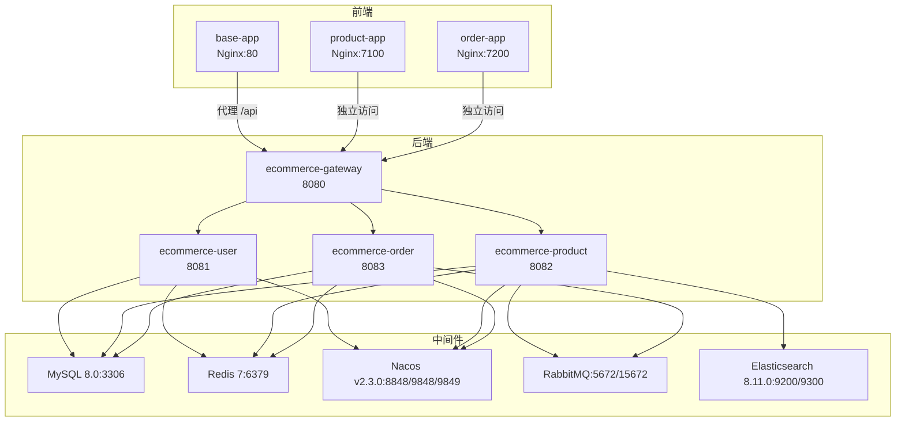
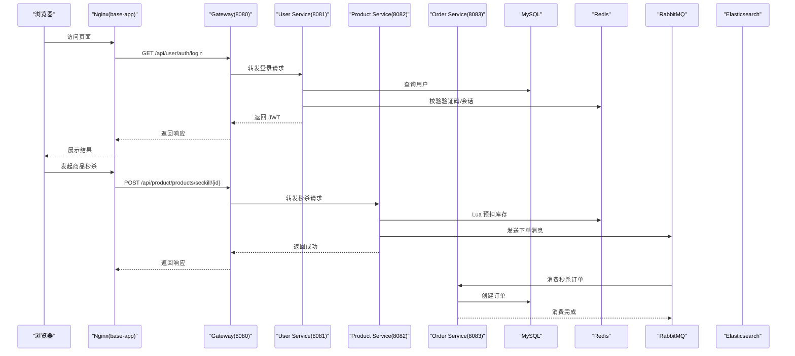
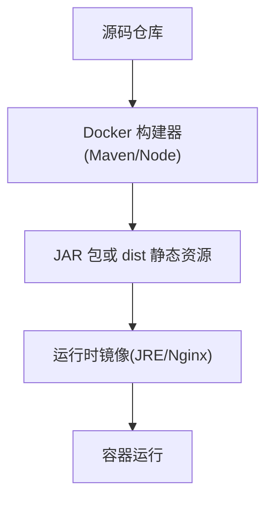
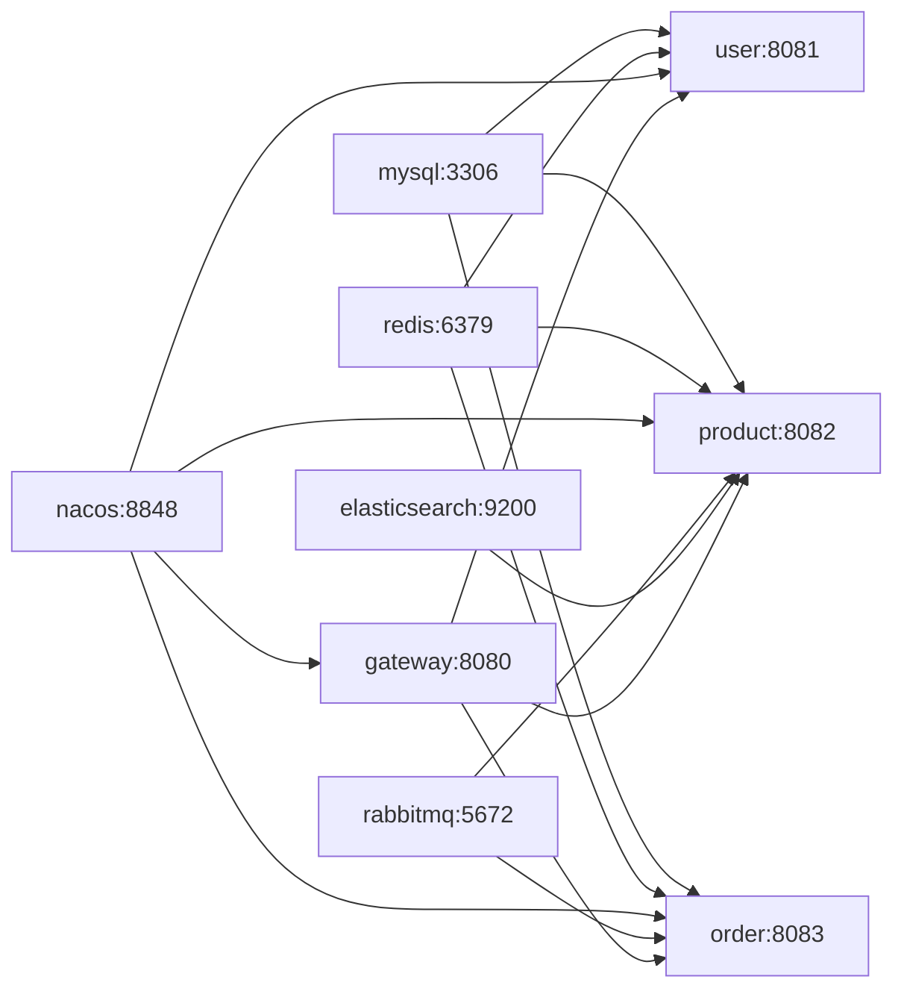
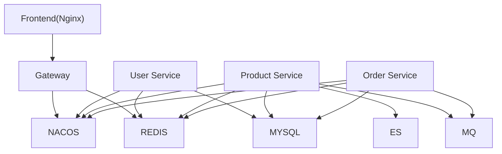

# 部署与运维

<cite>
**本文引用的文件**   
- [README.md](file://README.md)
- [docker-compose.yml](file://docker-compose.yml)
- [docker-compose-infra.yml](file://docker-compose-infra.yml)
- [backend/Dockerfile.gateway](file://backend/Dockerfile.gateway)
- [backend/Dockerfile.user](file://backend/Dockerfile.user)
- [backend/Dockerfile.product](file://backend/Dockerfile.product)
- [backend/Dockerfile.order](file://backend/Dockerfile.order)
- [frontend/base-app/Dockerfile](file://frontend/base-app/Dockerfile)
- [frontend/product-app/Dockerfile](file://frontend/product-app/Dockerfile)
- [frontend/order-app/Dockerfile](file://frontend/order-app/Dockerfile)
- [frontend/base-app/nginx.conf](file://frontend/base-app/nginx.conf)
</cite>

## 目录
1. [简介](#简介)
2. [项目结构](#项目结构)
3. [核心组件](#核心组件)
4. [架构总览](#架构总览)
5. [详细组件分析](#详细组件分析)
6. [依赖关系分析](#依赖关系分析)
7. [性能考虑](#性能考虑)
8. [故障诊断指南](#故障诊断指南)
9. [结论](#结论)
10. [附录](#附录)

## 简介
本指南面向生产环境的容器化部署与运维，覆盖镜像构建、容器编排、环境变量配置、服务依赖管理；阐述负载均衡、服务发现、配置中心、日志收集、监控告警等生产策略；提供运维监控方案（性能监控、链路追踪、错误收集、容量规划）；并给出部署架构图、配置文件示例、运维脚本建议，以及故障诊断方法、性能调优技巧与安全加固措施。

## 项目结构
本项目采用前后端分离的微服务架构：
- 后端：Spring Cloud Gateway 网关 + 用户/商品/订单微服务，依赖 MySQL、Redis、Nacos、RabbitMQ、Elasticsearch。
- 前端：qiankun 微前端主应用与两个子应用，通过 Nginx 静态托管并通过网关访问后端 API。
- 基础设施：MySQL、Redis、Nacos、RabbitMQ、Elasticsearch 以 Docker Compose 编排。

图示来源
- [docker-compose.yml:4-185](file://docker-compose.yml#L4-L185)
- [docker-compose-infra.yml:4-125](file://docker-compose-infra.yml#L4-L125)
- [frontend/base-app/nginx.conf:12-19](file://frontend/base-app/nginx.conf#L12-L19)

章节来源
- [README.md:16-47](file://README.md#L16-L47)
- [docker-compose.yml:4-185](file://docker-compose.yml#L4-L185)
- [docker-compose-infra.yml:4-125](file://docker-compose-infra.yml#L4-L125)

## 核心组件
- 网关（ecommerce-gateway）：统一入口、JWT 鉴权、路由分发、Swagger 聚合。
- 用户服务（ecommerce-user）：认证、用户管理、短信/验证码、主题偏好。
- 商品服务（ecommerce-product）：商品 CRUD、ES 搜索、秒杀库存预扣（Lua）、RabbitMQ 异步下单。
- 订单服务（ecommerce-order）：订单管理、秒杀订单消费（RabbitMQ）。
- 前端基座（base-app）：Vue 3 主应用，qiankun 容器，Nginx 托管，API 代理到网关。
- 前端子应用（product-app、order-app）：React/TS 子应用，Nginx 托管。
- 中间件：MySQL、Redis、Nacos、RabbitMQ、Elasticsearch。

章节来源
- [README.md:5-14](file://README.md#L5-L14)
- [README.md:218-240](file://README.md#L218-L240)
- [README.md:430-477](file://README.md#L430-L477)

## 架构总览
系统对外暴露统一入口（网关），前端通过 Nginx 代理 API 请求至网关，网关按路径前缀路由到下游微服务。微服务通过 Nacos 进行服务注册与发现，使用 Redis 做缓存与会话，RabbitMQ 处理异步消息，Elasticsearch 提供搜索能力，MySQL 存储持久化数据。

图示来源
- [frontend/base-app/nginx.conf:12-19](file://frontend/base-app/nginx.conf#L12-L19)
- [docker-compose.yml:70-158](file://docker-compose.yml#L70-L158)
- [README.md:406-413](file://README.md#L406-L413)
- [README.md:366-379](file://README.md#L366-L379)

## 详细组件分析

### 镜像构建与运行
- 后端各服务均使用多阶段构建：Maven 构建阶段打包 JAR，JRE 运行阶段仅包含运行时依赖，减小镜像体积。
- 前端子应用使用 Node 构建静态资源，再由 Nginx 托管。

图示来源
- [backend/Dockerfile.gateway:1-22](file://backend/Dockerfile.gateway#L1-L22)
- [backend/Dockerfile.user:1-22](file://backend/Dockerfile.user#L1-L22)
- [backend/Dockerfile.product:1-22](file://backend/Dockerfile.product#L1-L22)
- [backend/Dockerfile.order:1-22](file://backend/Dockerfile.order#L1-L22)
- [frontend/base-app/Dockerfile:1-12](file://frontend/base-app/Dockerfile#L1-L12)
- [frontend/product-app/Dockerfile:1-12](file://frontend/product-app/Dockerfile#L1-L12)
- [frontend/order-app/Dockerfile:1-12](file://frontend/order-app/Dockerfile#L1-L12)

章节来源
- [backend/Dockerfile.gateway:1-22](file://backend/Dockerfile.gateway#L1-L22)
- [backend/Dockerfile.user:1-22](file://backend/Dockerfile.user#L1-L22)
- [backend/Dockerfile.product:1-22](file://backend/Dockerfile.product#L1-L22)
- [backend/Dockerfile.order:1-22](file://backend/Dockerfile.order#L1-L22)
- [frontend/base-app/Dockerfile:1-12](file://frontend/base-app/Dockerfile#L1-L12)
- [frontend/product-app/Dockerfile:1-12](file://frontend/product-app/Dockerfile#L1-L12)
- [frontend/order-app/Dockerfile:1-12](file://frontend/order-app/Dockerfile#L1-L12)

### 容器编排与服务依赖
- docker-compose.yml 定义全栈服务：基础设施 + 后端微服务 + 前端子应用。
- docker-compose-infra.yml 仅启动中间件，便于单独复用。
- 服务间通过 depends_on 与 healthcheck 控制启动顺序与健康状态。
- 环境变量注入数据库、Redis、RabbitMQ、Nacos 连接信息。

图示来源
- [docker-compose.yml:4-185](file://docker-compose.yml#L4-L185)
- [docker-compose-infra.yml:4-125](file://docker-compose-infra.yml#L4-L125)

章节来源
- [docker-compose.yml:4-185](file://docker-compose.yml#L4-L185)
- [docker-compose-infra.yml:4-125](file://docker-compose-infra.yml#L4-L125)

### 环境变量与配置中心
- 通过环境变量注入 Spring Profile、数据源、Redis、RabbitMQ、Nacos 地址等。
- Nacos 作为服务注册与配置中心，支持动态配置（当前为 standalone 模式）。
- 生产环境建议将敏感配置（如密码）放入密钥管理系统，并通过环境变量或挂载 Secret 注入。

章节来源
- [docker-compose.yml:82-158](file://docker-compose.yml#L82-L158)
- [docker-compose-infra.yml:52-70](file://docker-compose-infra.yml#L52-L70)
- [README.md:478-502](file://README.md#L478-L502)

### 前端 Nginx 代理与路由
- base-app 的 Nginx 将 /api 请求代理到网关，同时开启静态资源缓存与 history 模式 fallback。
- product-app 与 order-app 分别独立端口由 Nginx 托管。

章节来源
- [frontend/base-app/nginx.conf:1-27](file://frontend/base-app/nginx.conf#L1-L27)
- [frontend/product-app/Dockerfile:1-12](file://frontend/product-app/Dockerfile#L1-L12)
- [frontend/order-app/Dockerfile:1-12](file://frontend/order-app/Dockerfile#L1-L12)

### 网关鉴权与下游信任
- 网关对未白名单路径进行 JWT 校验，通过后透传 X-User-Id/X-User-Name 给下游。
- 下游服务信任网关注入的请求头，避免重复校验。

章节来源
- [README.md:406-413](file://README.md#L406-L413)

### 秒杀流程与异步解耦
- 商品服务通过 Redis Lua 原子预扣库存，随后向 RabbitMQ 发送消息。
- 订单服务消费消息创建订单，实现高并发下的异步解耦与削峰。

章节来源
- [README.md:366-379](file://README.md#L366-L379)

## 依赖关系分析
- 网关依赖 Nacos、Redis（用于鉴权相关逻辑）。
- 用户服务依赖 MySQL、Redis、Nacos。
- 商品服务依赖 MySQL、Redis、Elasticsearch、RabbitMQ、Nacos。
- 订单服务依赖 MySQL、Redis、RabbitMQ、Nacos。
- 前端依赖网关（通过 Nginx 代理）。

图示来源
- [docker-compose.yml:70-158](file://docker-compose.yml#L70-L158)
- [docker-compose-infra.yml:4-125](file://docker-compose-infra.yml#L4-L125)

章节来源
- [docker-compose.yml:70-158](file://docker-compose.yml#L70-L158)
- [docker-compose-infra.yml:4-125](file://docker-compose-infra.yml#L4-L125)

## 性能考虑
- 中间件资源限制：Nacos、Elasticsearch 已设置较小 JVM 内存，适合开发/测试环境；生产需根据负载调整。
- 数据库字符集与时区：MySQL 使用 utf8mb4 与 Asia/Shanghai 时区，避免乱码与时差问题。
- 前端静态资源缓存：Nginx 对静态资源启用长期缓存，提升加载性能。
- 秒杀场景：Redis Lua 预扣库存 + RabbitMQ 异步下单，降低数据库压力，提高吞吐。

章节来源
- [docker-compose-infra.yml:60-66](file://docker-compose-infra.yml#L60-L66)
- [docker-compose-infra.yml:101-105](file://docker-compose-infra.yml#L101-L105)
- [docker-compose-infra.yml:22-26](file://docker-compose-infra.yml#L22-L26)
- [frontend/base-app/nginx.conf:21-25](file://frontend/base-app/nginx.conf#L21-L25)
- [README.md:366-379](file://README.md#L366-L379)

## 故障诊断指南
- 健康检查：
  - MySQL：mysqladmin ping
  - Redis：redis-cli ping
  - Nacos：HTTP 探测 nacos 控制台
  - RabbitMQ：rabbitmq-diagnostics ping
  - Elasticsearch：/_cluster/health
- 常见问题定位：
  - 中文乱码：确保 MySQL 客户端与服务器字符集一致（utf8mb4），容器内 LANG/LC_ALL 设置为 C.UTF-8。
  - 服务无法注册：检查 Nacos 地址与网络连通性。
  - 秒杀失败：检查 Redis Lua 脚本执行与 RabbitMQ 队列是否可用。
  - 前端无法调用后端：确认 Nginx 代理规则与网关可达性。

章节来源
- [docker-compose-infra.yml:27-31](file://docker-compose-infra.yml#L27-L31)
- [docker-compose-infra.yml:44-48](file://docker-compose-infra.yml#L44-L48)
- [docker-compose-infra.yml:66-70](file://docker-compose-infra.yml#L66-L70)
- [docker-compose-infra.yml:86-90](file://docker-compose-infra.yml#L86-L90)
- [docker-compose-infra.yml:108-112](file://docker-compose-infra.yml#L108-L112)
- [docker-compose-infra.yml:14-18](file://docker-compose-infra.yml#L14-L18)
- [frontend/base-app/nginx.conf:12-19](file://frontend/base-app/nginx.conf#L12-L19)

## 结论
本项目通过 Docker Compose 实现了从基础设施到前后端的完整容器化编排，结合 Nacos 服务发现与配置中心、RabbitMQ 异步解耦、Elasticsearch 搜索能力，构建了可扩展的电商微服务架构。在生产环境中，应进一步引入负载均衡、集中式日志、APM 链路追踪、指标监控与告警体系，完善安全加固与容量规划，保障系统的高可用与可观测性。

## 附录

### 生产部署策略建议
- 负载均衡
  - 在网关前部署反向代理（如 Nginx/HAProxy/Kong），对多个网关实例进行轮询或加权分配。
  - 前端静态资源通过 CDN 加速，减少源站压力。
- 服务发现与配置中心
  - 使用 Nacos 集群模式，开启鉴权与加密传输，配置多数据中心容灾。
  - 将敏感配置（数据库密码、Redis 密码、RabbitMQ 凭据）纳入密钥管理（如 Vault/K8s Secrets）。
- 日志收集
  - 后端输出结构化 JSON 日志，配合 Filebeat/Fluent Bit 采集至 ELK/EFK。
  - 前端接入错误上报（如 Sentry），并结合网关访问日志统一分析。
- 监控告警
  - 指标：JVM、GC、线程池、数据库连接池、Redis 命中率、RabbitMQ 队列积压、Elasticsearch 索引延迟。
  - 工具：Prometheus + Grafana 可视化，Alertmanager 告警；APM 使用 SkyWalking/Jaeger 进行链路追踪。
- 容量规划
  - 基于压测结果确定各服务副本数与中间件规格；对热点数据（秒杀库存）评估 Redis 分片与持久化策略。
  - 数据库读写分离与分库分表预案；Elasticsearch 分片与副本数按数据量规划。

[本节为通用指导，不直接分析具体文件]

### 运维脚本建议
- 一键启动/停止
  - 基础设施：docker compose -f docker-compose-infra.yml up -d/down
  - 全栈：docker compose up -d/down
- 健康检查脚本
  - 循环探测 MySQL/Redis/Nacos/RabbitMQ/Elasticsearch 健康接口，异常时触发告警。
- 日志滚动与清理
  - 配置 logrotate 或使用容器日志驱动（json-file）限制大小与保留天数。
- 备份与恢复
  - MySQL：mysqldump 定时备份；Redis：rdb/aof 定期快照；Elasticsearch：Snapshot & Restore。

[本节为通用指导，不直接分析具体文件]

### 安全加固措施
- 最小权限原则：数据库、Redis、RabbitMQ、Nacos 账号仅授予必要权限。
- 网络隔离：中间件仅对内网开放，网关对外暴露；必要时使用 VPC/安全组。
- 传输加密：启用 TLS（网关、Nacos、ES），禁用明文访问。
- 鉴权与审计：Nacos 开启鉴权，RabbitMQ 启用用户名密码，ES 关闭 xpack.security.enabled 时需额外防护。
- 输入校验与限流：网关层对恶意请求限流，业务层参数校验与防重放。

[本节为通用指导，不直接分析具体文件]