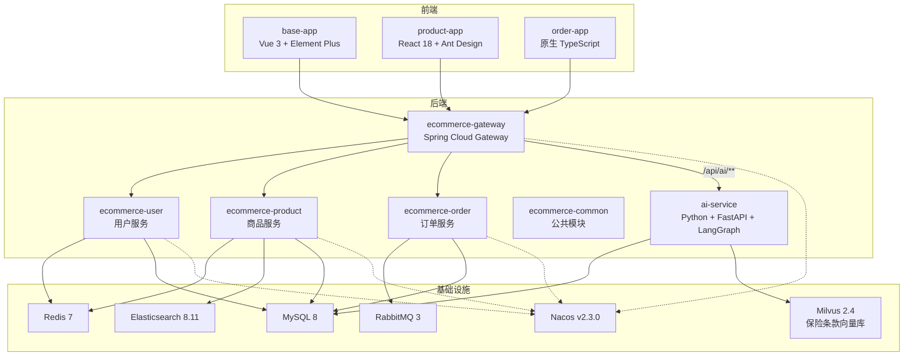
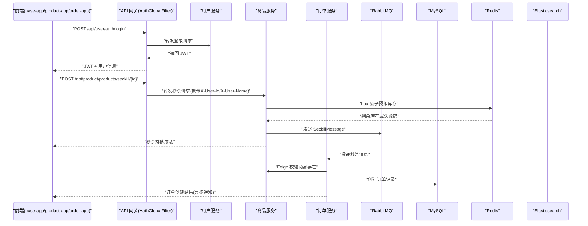
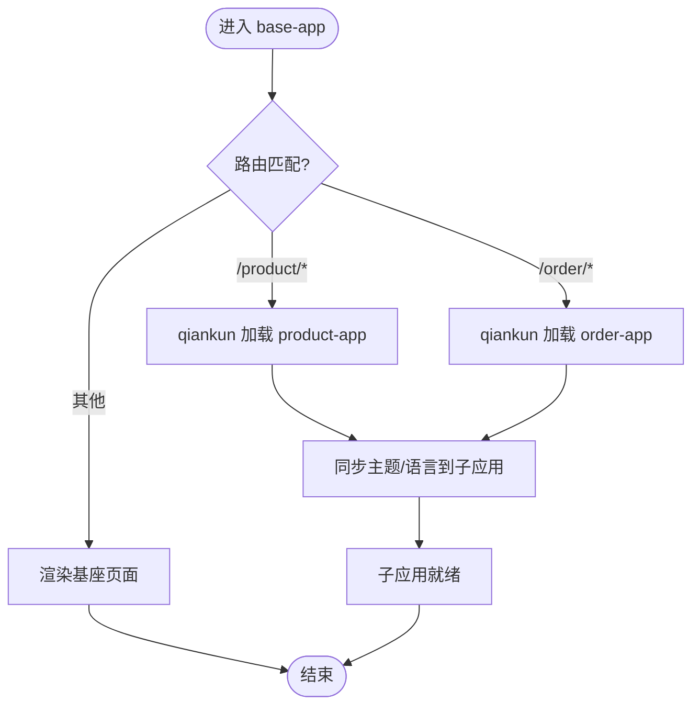
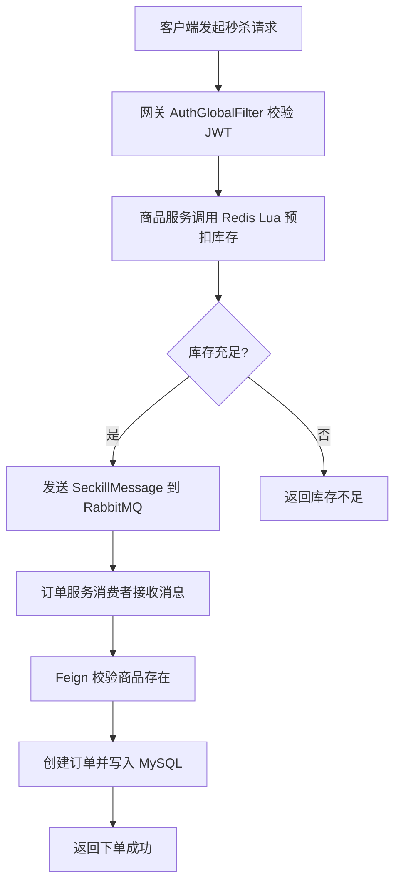
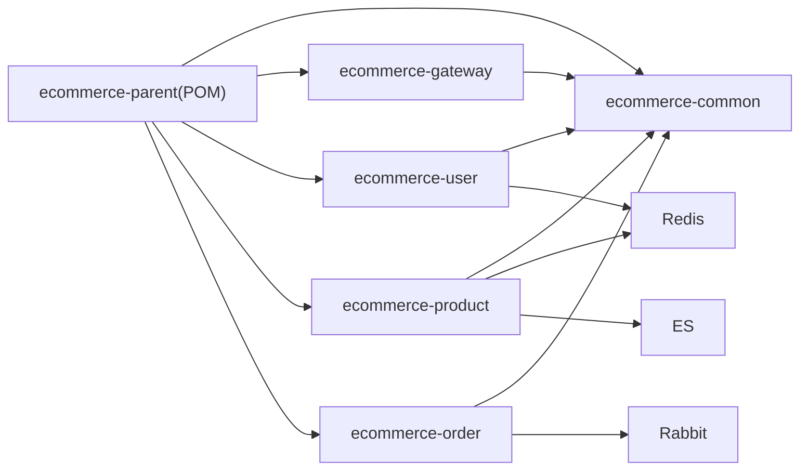

# 项目概述

<cite>
**本文引用的文件**   
- [README.md](file://README.md)
- [backend/pom.xml](file://backend/pom.xml)
- [docker-compose.yml](file://docker-compose.yml)
- [frontend/base-app/package.json](file://frontend/base-app/package.json)
- [AuthGlobalFilter.java](file://backend/ecommerce-gateway/src/main/java/com/ecommerce/gateway/filter/AuthGlobalFilter.java)
- [seckill_stock.lua](file://backend/ecommerce-product/src/main/resources/lua/seckill_stock.lua)
- [SeckillOrderConsumer.java](file://backend/ecommerce-order/src/main/java/com/ecommerce/order/consumer/SeckillOrderConsumer.java)
- [Result.java](file://backend/ecommerce-common/src/main/java/com/ecommerce/common/Result.java)
- [base-app micro/index.ts](file://frontend/base-app/src/micro/index.ts)
- [base-app App.vue](file://frontend/base-app/src/App.vue)
- [product-app App.tsx](file://frontend/product-app/src/App.tsx)
- [ai-service/main.py](file://ai-service/app/main.py)
- [docker-compose.milvus.yml](file://docker-compose.milvus.yml)
</cite>

## 目录
1. [引言](#引言)
2. [项目结构](#项目结构)
3. [核心组件](#核心组件)
4. [架构总览](#架构总览)
5. [详细组件分析](#详细组件分析)
6. [依赖关系分析](#依赖关系分析)
7. [性能与高并发设计](#性能与高并发设计)
8. [故障排查指南](#故障排查指南)
9. [结论](#结论)

## 引言
本项目是一个前后端分离的全栈微服务电商示例，后端采用 Spring Cloud 微服务架构，前端采用 qiankun 微前端架构。系统通过 API 网关统一入口、JWT 统一认证、Redis Lua 原子性预扣库存、RabbitMQ 异步消息解耦秒杀下单，并结合 Elasticsearch 提供商品搜索能力。前端主应用负责全局主题、语言、用户状态与子应用容器，商品与订单子应用分别由 React 和原生 TypeScript 实现，支持暗黑模式与多语言。

在 Java 微服务之外，仓库还包含一个 Python 编写的 AI 问答微服务 ai-service：基于 FastAPI + LangChain/LangGraph，从保险条款 PDF 构建知识库，向量存入 Milvus，通过 SSE 向商品子应用的保险咨询机器人流式输出回答；同时订单服务接入支付宝沙箱支付、商品服务接入阿里云 OSS 图片上传（未配置凭证时落本地磁盘），共同构成完整的交易与咨询闭环。

该文档面向初学者与有经验的开发者：前者可通过架构图和数据流图理解系统全貌；后者可关注技术选型背景、关键路径的性能权衡与扩展点。

## 项目结构
后端按业务域拆分为 5 个 Maven 模块：公共模块、网关、用户、商品、订单，另有一个独立的 Python 服务 ai-service（不参与 Maven 构建）。前端按 qiankun 微前端拆分为 3 个子应用：主应用 base-app、商品子应用 product-app、订单子应用 order-app。基础设施（MySQL、Redis、Nacos、RabbitMQ、Elasticsearch）通过 Docker Compose 编排；Milvus 向量库由独立的 docker-compose.milvus.yml 部署（默认在 VM 上）。

**图表来源**
- [README.md:16-47](file://README.md#L16-L47)
- [docker-compose.yml:5-179](file://docker-compose.yml#L5-L179)

**章节来源**
- [README.md:1-14](file://README.md#L1-L14)
- [backend/pom.xml:21-27](file://backend/pom.xml#L21-L27)
- [docker-compose.yml:69-179](file://docker-compose.yml#L69-L179)

## 核心组件
- 公共模块 ecommerce-common：定义统一响应 Result、业务异常、全局异常处理、秒杀消息体 SeckillMessage，被其他微服务复用。
- API 网关 ecommerce-gateway：Spring Cloud Gateway 作为统一入口，集中 JWT 鉴权、路由分发、Swagger 聚合。
- 用户服务 ecommerce-user：注册、登录、图片验证码、短信验证码、用户 CRUD、会话管理、主题偏好。
- 商品服务 ecommerce-product：商品 CRUD、Elasticsearch 搜索、秒杀库存预扣（Redis Lua）、向 RabbitMQ 发送秒杀消息；商品图片上传（阿里云 OSS，未配置凭证时本地兜底）。
- 订单服务 ecommerce-order：订单 CRUD、通过 OpenFeign 调用商品服务、消费 RabbitMQ 秒杀消息创建订单；支付宝沙箱支付（下单、异步通知、主动查询）。
- AI 问答微服务 ai-service：Python + FastAPI，PDF 知识库构建、RAG 检索、SSE 流式问答、会话与检查点；向量存 Milvus，业务数据存 MySQL（ai_* 表）。
- 前端主应用 base-app：qiankun 主应用，负责登录、注册、用户管理、子应用容器、全局主题与语言切换。
- 商品子应用 product-app：商品列表、详情、秒杀与「立即购买」入口，保险商品咨询机器人（对话/回溯/知识库），基于 React + Ant Design。
- 订单子应用 order-app：我的订单、全部订单、订单详情、支付结果页轮询，原生 TypeScript。

**章节来源**
- [README.md:5-14](file://README.md#L5-L14)
- [Result.java:1-64](file://backend/ecommerce-common/src/main/java/com/ecommerce/common/Result.java#L1-L64)

## 架构总览
系统边界清晰：前端通过 qiankun 在主应用中加载子应用；所有后端请求经网关统一鉴权和路由；业务微服务各自维护数据库，并通过 Redis、RabbitMQ、Elasticsearch 等中间件完成缓存、异步与搜索。

**图表来源**
- [AuthGlobalFilter.java:31-40](file://backend/ecommerce-gateway/src/main/java/com/ecommerce/gateway/filter/AuthGlobalFilter.java#L31-L40)
- [AuthGlobalFilter.java:80-140](file://backend/ecommerce-gateway/src/main/java/com/ecommerce/gateway/filter/AuthGlobalFilter.java#L80-L140)
- [seckill_stock.lua:1-13](file://backend/ecommerce-product/src/main/resources/lua/seckill_stock.lua#L1-L13)
- [SeckillOrderConsumer.java:35-67](file://backend/ecommerce-order/src/main/java/com/ecommerce/order/consumer/SeckillOrderConsumer.java#L35-L67)
- [README.md:366-379](file://README.md#L366-L379)

## 详细组件分析

### 后端微服务职责划分
- 公共模块 ecommerce-common
  - 统一响应 Result：code/message/data 三字段结构，贯穿所有接口。
  - 业务异常与全局异常处理器：将业务错误包装为 Result，保持 HTTP 200 但 code 非 200。
  - 秒杀消息体 SeckillMessage：用于 RabbitMQ 传输的 DTO。
- 网关 ecommerce-gateway
  - AuthGlobalFilter：白名单放行、JWT 解析、签名与有效期校验、透传 X-User-Id/X-User-Name。
  - Swagger 聚合：文档路径加入白名单，无需 Token 访问。
- 用户服务 ecommerce-user
  - 认证流程：登录返回 JWT，前端存储后每次请求携带 Authorization: Bearer <token>。
  - 安全策略：网关统一校验，下游信任网关注入的请求头。
- 商品服务 ecommerce-product
  - 秒杀库存预扣：Redis Lua 脚本保证原子性，防止超卖。
  - 搜索引擎：Elasticsearch 同步商品索引，支持关键词、分类、价格区间搜索。
  - 图片存储：`FileStorageServiceRouter` 按 `oss.isConfigured()` 在 OSS 与本地磁盘之间切换，对外只暴露 URL。
- 订单服务 ecommerce-order
  - 异步下单：消费 RabbitMQ 中的 SeckillMessage，创建订单并持久化到 MySQL。
  - 跨服务调用：OpenFeign 调用商品服务校验商品存在。
  - 支付：接入支付宝沙箱 page pay，回调验签 + 条件更新保证幂等，结果页轮询兜底。
- AI 问答微服务 ai-service
  - RAG 链路：MinerU 解析 PDF → 文本切分 → 百炼 embedding → Milvus 检索 → 智谱 GLM 生成。
  - 拒答门控：检索分数低于阈值时不调用大模型，直接返回固定拒答话术；SSE 帧序为 meta → token → done。

**章节来源**
- [Result.java:1-64](file://backend/ecommerce-common/src/main/java/com/ecommerce/common/Result.java#L1-L64)
- [AuthGlobalFilter.java:31-40](file://backend/ecommerce-gateway/src/main/java/com/ecommerce/gateway/filter/AuthGlobalFilter.java#L31-L40)
- [AuthGlobalFilter.java:80-140](file://backend/ecommerce-gateway/src/main/java/com/ecommerce/gateway/filter/AuthGlobalFilter.java#L80-L140)
- [seckill_stock.lua:1-13](file://backend/ecommerce-product/src/main/resources/lua/seckill_stock.lua#L1-L13)
- [SeckillOrderConsumer.java:35-67](file://backend/ecommerce-order/src/main/java/com/ecommerce/order/consumer/SeckillOrderConsumer.java#L35-L67)
- [README.md:366-379](file://README.md#L366-L379)

### 前端微前端职责划分
- 主应用 base-app
  - qiankun 主应用：注册 product-app 与 order-app，通过 activeRule 控制路由挂载。
  - 全局状态：token、用户信息、主题、语言，通过 initGlobalState 与 onGlobalStateChange 同步给子应用。
  - UI 布局：Element Plus 导航、主题切换按钮、国际化、登出逻辑。
- 商品子应用 product-app
  - React + Ant Design：商品列表、详情、秒杀入口，支持暗黑模式与多语言。
  - 主题同步：监听 localStorage 与 MutationObserver，响应主应用主题变化。
- 订单子应用 order-app
  - 原生 TypeScript：订单列表、详情、取消操作，暗黑模式颜色适配。

**图表来源**
- [base-app micro/index.ts:1-79](file://frontend/base-app/src/micro/index.ts#L1-L79)
- [base-app App.vue:25-107](file://frontend/base-app/src/App.vue#L25-L107)
- [product-app App.tsx:20-50](file://frontend/product-app/src/App.tsx#L20-L50)

**章节来源**
- [frontend/base-app/package.json:11-18](file://frontend/base-app/package.json#L11-L18)
- [base-app micro/index.ts:1-79](file://frontend/base-app/src/micro/index.ts#L1-L79)
- [base-app App.vue:25-107](file://frontend/base-app/src/App.vue#L25-L107)
- [product-app App.tsx:20-50](file://frontend/product-app/src/App.tsx#L20-L50)

### 高并发秒杀技术实现
- Redis Lua 原子性预扣库存
  - 脚本读取库存 key，判断是否初始化与是否足够，DECRBY 原子扣减，返回剩余库存。
  - 优点：单条命令执行，避免并发超卖；适合热点数据快速落库前拦截。
- RabbitMQ 异步消息处理
  - 商品服务扣减成功后发送 SeckillMessage 到队列；订单服务消费者拉取消息，校验商品并创建订单。
  - 优点：削峰填谷，提升吞吐；失败重试与死信队列保障可靠性。
- JWT 统一认证
  - 网关层解析 JWT，校验签名与有效期，透传用户信息至下游；下游信任网关注入的请求头，避免重复校验。
  - 优点：集中鉴权、降低各服务复杂度；提高安全性与一致性。

**图表来源**
- [AuthGlobalFilter.java:80-140](file://backend/ecommerce-gateway/src/main/java/com/ecommerce/gateway/filter/AuthGlobalFilter.java#L80-L140)
- [seckill_stock.lua:1-13](file://backend/ecommerce-product/src/main/resources/lua/seckill_stock.lua#L1-L13)
- [SeckillOrderConsumer.java:35-67](file://backend/ecommerce-order/src/main/java/com/ecommerce/order/consumer/SeckillOrderConsumer.java#L35-L67)

**章节来源**
- [README.md:366-379](file://README.md#L366-L379)

## 依赖关系分析
- 版本与依赖管理
  - 父 POM 统一管理 Spring Boot、Spring Cloud、Spring Cloud Alibaba、JWT、springdoc 版本。
  - 模块依赖：ecommerce-common 被 gateway/user/product/order 复用。
- 运行时依赖
  - 网关依赖 Redis（会话/限流可扩展）、Nacos（服务发现/配置）。
  - 商品服务依赖 Redis、Elasticsearch、RabbitMQ。
  - 订单服务依赖 RabbitMQ、MySQL。
  - 用户服务依赖 Redis、MySQL。
  - ai-service 依赖 MySQL（ai_* 表）、Milvus（insurance_chunks 集合）、智谱/百炼/MinerU 外部 API，以及网关透传的 X-User-* 身份头。
- 前端依赖
  - base-app 依赖 qiankun、vue-router、element-plus、axios、i18n。
  - product-app 依赖 react、antd、react-router-dom、i18n。
  - order-app 使用原生 TS + Vite。

**图表来源**
- [backend/pom.xml:21-63](file://backend/pom.xml#L21-L63)
- [docker-compose.yml:5-179](file://docker-compose.yml#L5-L179)

**章节来源**
- [backend/pom.xml:21-63](file://backend/pom.xml#L21-L63)
- [docker-compose.yml:5-179](file://docker-compose.yml#L5-L179)

## 性能与高并发设计
- 网关层
  - 使用 WebFlux 非阻塞模型，适合高并发场景；JWT 校验在网关集中处理，减少下游开销。
- 缓存层
  - Redis 用于会话、验证码、秒杀库存预扣；Lua 脚本保证原子性，避免锁竞争与超卖。
- 消息队列
  - RabbitMQ 异步解耦秒杀下单，削峰填谷；消费者幂等与重试机制需结合业务完善。
- 搜索引擎
  - Elasticsearch 提供高性能商品检索，减轻 MySQL 压力。
- 前端
  - qiankun 微前端隔离子应用运行环境，支持独立开发与部署；主题与语言通过全局状态同步，避免重复计算。

[本节为通用性能讨论，不直接分析具体文件]

## 故障排查指南
- 鉴权失败
  - 现象：网关返回 401 JSON，提示未授权、Token 过期或无效。
  - 排查：检查 Authorization 头格式、JWT 签名与有效期、白名单路径是否正确。
  - 参考：AuthGlobalFilter 的白名单与异常分支。
- 秒杀库存不足
  - 现象：Lua 脚本返回 0 或负数，提示库存不足或未初始化。
  - 排查：确认秒杀库存已初始化到 Redis，检查 Lua 脚本 key 与参数。
- 订单创建失败
  - 现象：消费者日志报错，消息进入重试或死信队列。
  - 排查：检查 RabbitMQ 连接、Feign 调用商品服务、MySQL 写入权限与事务。
- 前端主题不同步
  - 现象：子应用暗黑模式未生效。
  - 排查：检查 base-app 的 globalActions 与子应用的 storage/MutationObserver 监听。
- 保险问答无回答或报错
  - 现象：SSE 返回 error 帧，或回答内容与条款无关。
  - 排查：检查 ai-service 是否启动（8084）、网关 `/api/ai/**` 路由与 HMAC 签名、Milvus 是否可达、知识库是否已上传并完成向量化。
- 图片上传失败
  - 现象：返回 503、413 或 400。
  - 排查：503 表示 OSS 凭证缺失；413 检查 nginx `client_max_body_size` 与 multipart 上限；400 多为文件魔数校验未通过。
- 支付回调不生效
  - 现象：支付宝已付款但订单仍为待支付。
  - 排查：确认 `ALIPAY_NOTIFY_URL` 公网可达、验签公钥为「支付宝公钥」、订单状态仍为 PENDING_PAYMENT。

**章节来源**
- [AuthGlobalFilter.java:80-140](file://backend/ecommerce-gateway/src/main/java/com/ecommerce/gateway/filter/AuthGlobalFilter.java#L80-L140)
- [seckill_stock.lua:1-13](file://backend/ecommerce-product/src/main/resources/lua/seckill_stock.lua#L1-L13)
- [SeckillOrderConsumer.java:35-67](file://backend/ecommerce-order/src/main/java/com/ecommerce/order/consumer/SeckillOrderConsumer.java#L35-L67)
- [base-app micro/index.ts:17-30](file://frontend/base-app/src/micro/index.ts#L17-L30)
- [product-app App.tsx:20-50](file://frontend/product-app/src/App.tsx#L20-L50)

## 结论
本项目以 Spring Cloud 微服务与 qiankun 微前端为核心，构建了清晰的系统边界与职责划分。网关统一鉴权与路由、Redis Lua 原子预扣、RabbitMQ 异步下单、Elasticsearch 搜索共同支撑高并发秒杀场景；在此之上叠加了三条独立的能力线：Java 侧的商品图片上传（OSS/本地兜底）与支付宝沙箱支付，Python 侧的保险条款 RAG 问答微服务（Milvus + SSE）。前端主应用提供统一的体验与状态管理，子应用独立开发部署，便于团队协作与演进。对于初学者，建议从 README 的启动步骤与架构图入手；对于经验开发者，可重点关注网关鉴权链路、Lua 脚本与消费者幂等性、支付回调幂等、以及 RAG 的检索门控与 SSE 协议设计。

[本节为总结性内容，不直接分析具体文件]